# Project Genesis

A procedural world generator and interactive desktop atlas viewer written in Rust.

The engine grows an 8K ($8192 \times 4096$) planet from 3D spherical noise, simulated
atmospheric circulation and hydrology, partitions **both the landmasses and the
world ocean** into a matching five-tier political hierarchy, and then **gives that
world a history**: a handful of civilizations rise where the planet is genuinely
best, spread until wilderness, mountains or an older neighbour stops them, and
carry a cradle, a culture, a faith and a population of their own. Everything below
was rendered from a single cached world (seed `3286592765982`), and a given seed
always reproduces the same planet.

---

## Atlas gallery

### Map scopes

| Scope | What it portrays |
| :--- | :--- |
| **🗺 Physical** | Pure relief: hillshaded hypsometric palette, biomes, rivers and ice. No politics. |
| **⛰ Topographic** | A survey sheet: colour *is* elevation, contoured at every band boundary, with metre readouts on hover. |
| **🌦 Climate** | Climate zones: land classified by mean temperature, annual rainfall and altitude; the sea by its surface temperature. |
| **🌡 Temperature** | Thermal belts as a number line, from deep violet cold to red-hot tropics, with a thin line on every 5 °C isotherm. |
| **🪨 Terrain** | Landform and bathymetry classes: abyssal plain, shelf, coastal lowland, hill country, upland, mountain and high mountain. |
| **🏺 Civilizations** | The dawn of history: the physical world with the realms that rose on it, each in its own colour, with a dark dot on the cradle province where it began. |
| **🏛 Land** | Political subdivision of the landmasses only; the ocean is plain water. |
| **🌊 Water** | The hydro-political subdivision of the world ocean only; the continents are muted. |
| **🌍 Everywhere** | Both hierarchies portrayed at once. |

The dawn is not confined to its own scope: the **Civilizations overlay** checkbox in
the toolbar tints the provinces each realm holds on top of *any* scope — physical,
survey, climatic, land or everywhere — so the same history can be read against the
relief, the climate or either political hierarchy.

Every scope opens fitted to the window and stays readable: **⤢ Fit** re-fits the whole
planet to the current canvas, hovering a province gives a short readout, and the
legends are live. In the **Topographic** scope the *Highest peak* and *Deepest trench*
figures are buttons that fly the map to the summit or the trench and ring it; in the
**Civilizations** scope, clicking a realm in the right-hand list flies the map to its
cradle and rings it. Hover cards stay short on purpose — a few lines on why a realm
rose, how it lives and what it believes; the full dossier is printed by `--civs`.

| 🗺 Physical | ⛰ Topographic | 🌦 Climate |
| :---: | :---: | :---: |
| [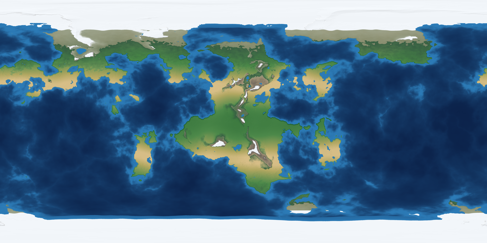](atlas_physical.png) | [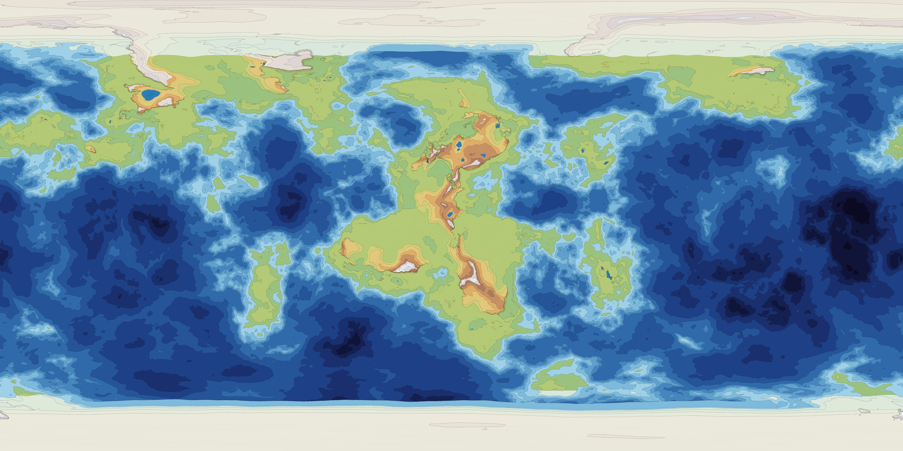](atlas_topographic.png) | [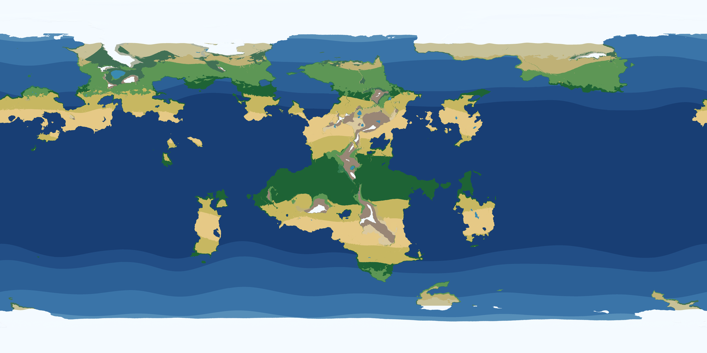](atlas_climate.png) |

| 🌡 Temperature | 🪨 Terrain | 🏺 Civilizations |
| :---: | :---: | :---: |
| [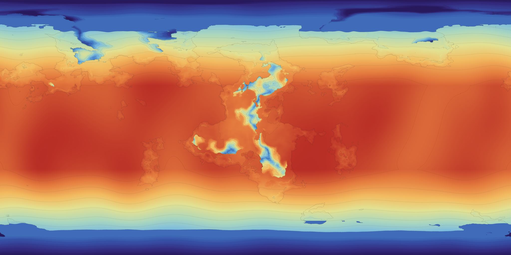](atlas_temperature.png) | [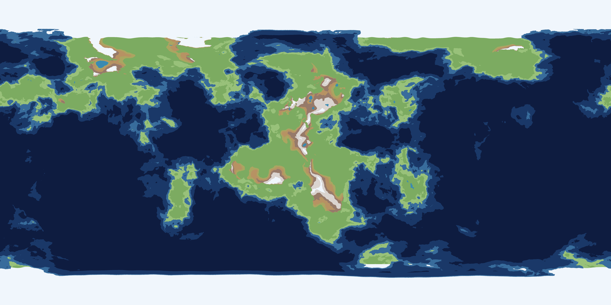](atlas_terrain.png) | [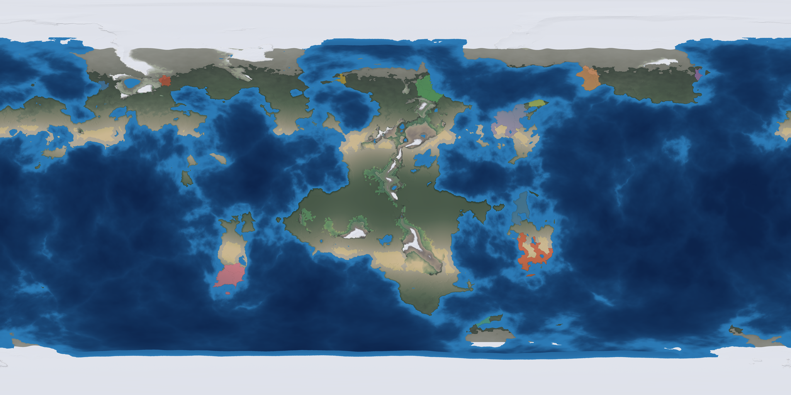](atlas_civilizations.png) |

| 🏛 Land | 🌊 Water | 🌍 Everywhere |
| :---: | :---: | :---: |
| [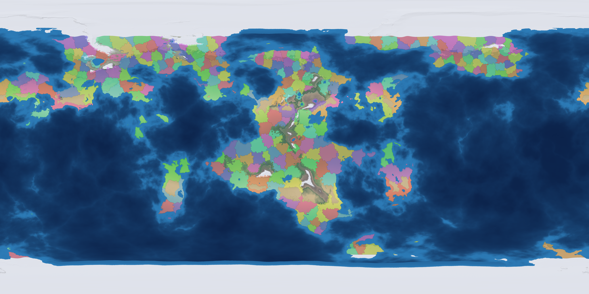](atlas_land_regions.png) | [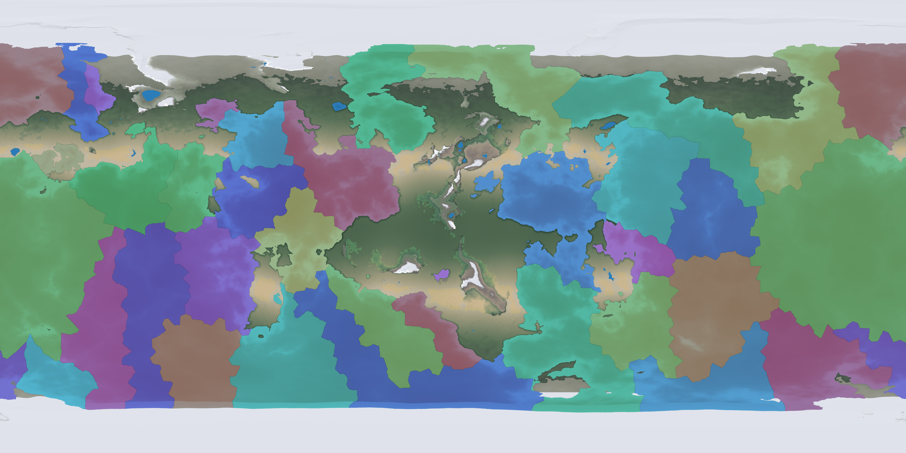](atlas_water_regions.png) | [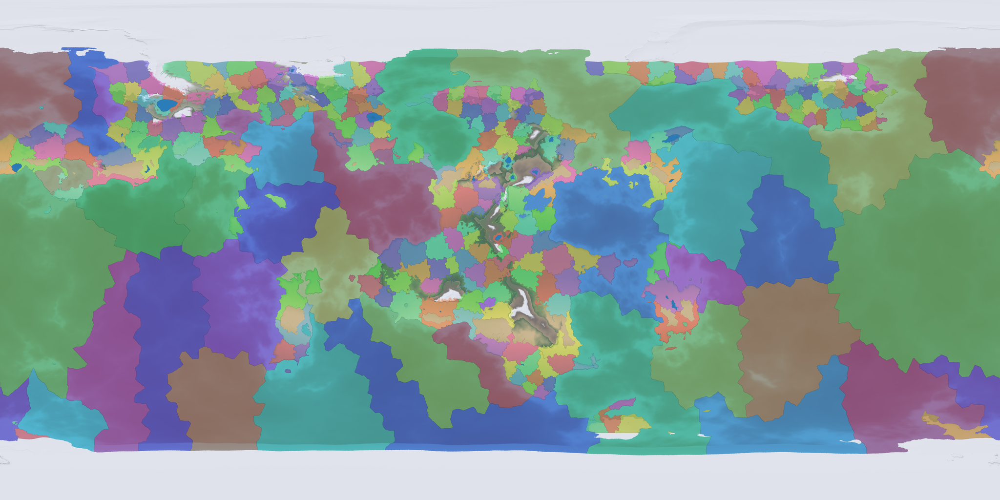](atlas_everywhere_regions.png) |

### Land tiers

The land hierarchy runs **Province → Area → Region → Superregion → Continent**. Each tier
is a pure reaggregation of the one below it, so switching tiers never moves a border, it
only coarsens the palette.

| Provinces | Areas | Regions | Superregions | Continents |
| :---: | :---: | :---: | :---: | :---: |
| [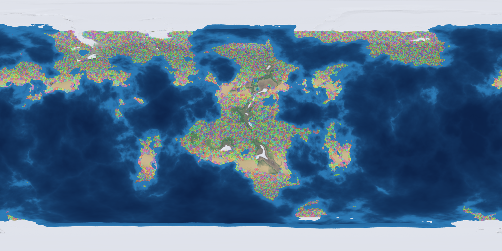](atlas_land_provinces.png) | [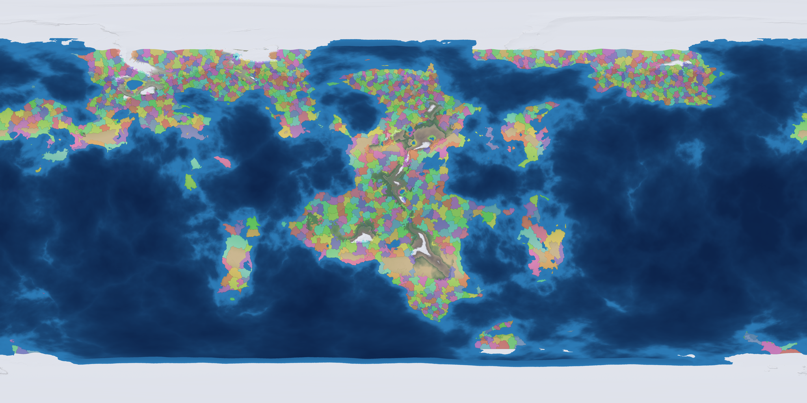](atlas_land_areas.png) | [](atlas_land_regions.png) | [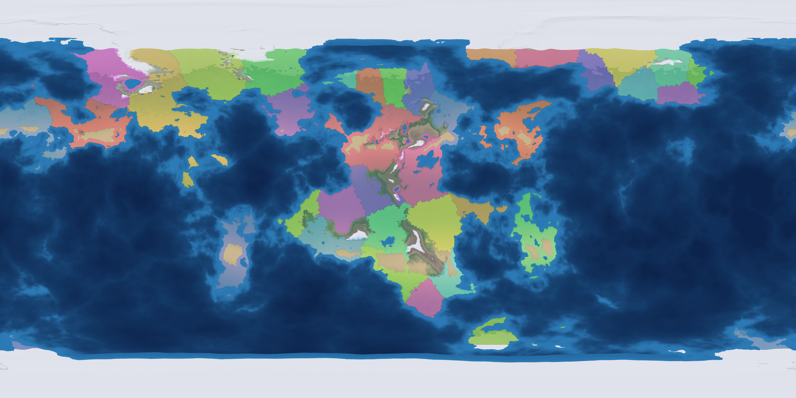](atlas_land_superregions.png) | [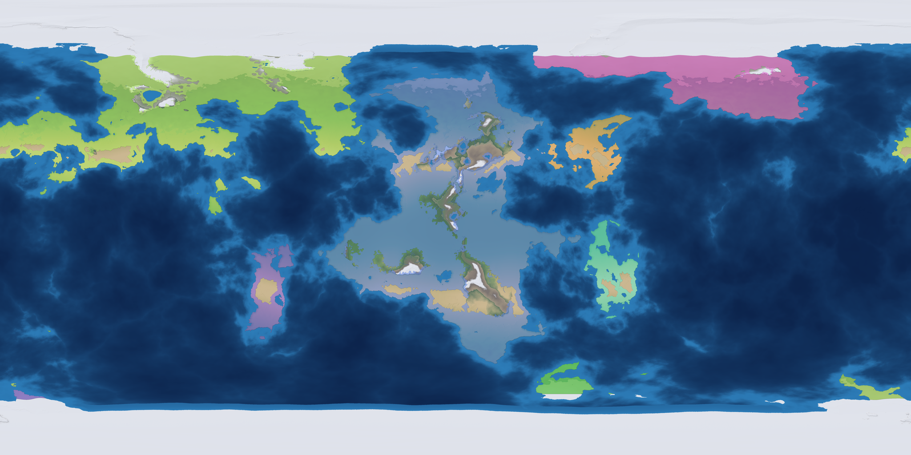](atlas_land_continents.png) |

### Ocean tiers

The world ocean — open water **and** the frozen polar seas — mirrors the same five tiers,
scaled up because it is one connected, far larger domain.

| Marine provinces | Oceanic areas | Oceanic regions | Oceanic superregions | Continental basins |
| :---: | :---: | :---: | :---: | :---: |
| [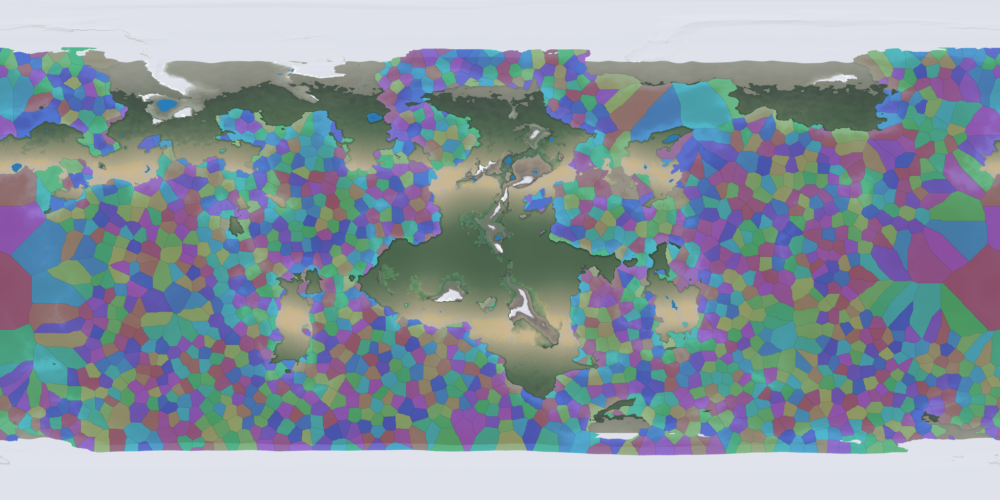](atlas_water_provinces.png) | [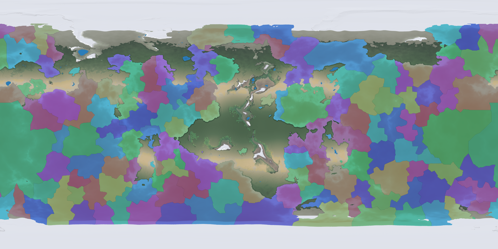](atlas_water_areas.png) | [](atlas_water_regions.png) | [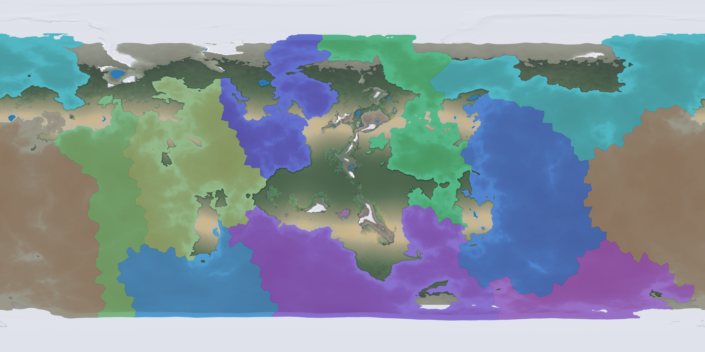](atlas_water_superregions.png) | [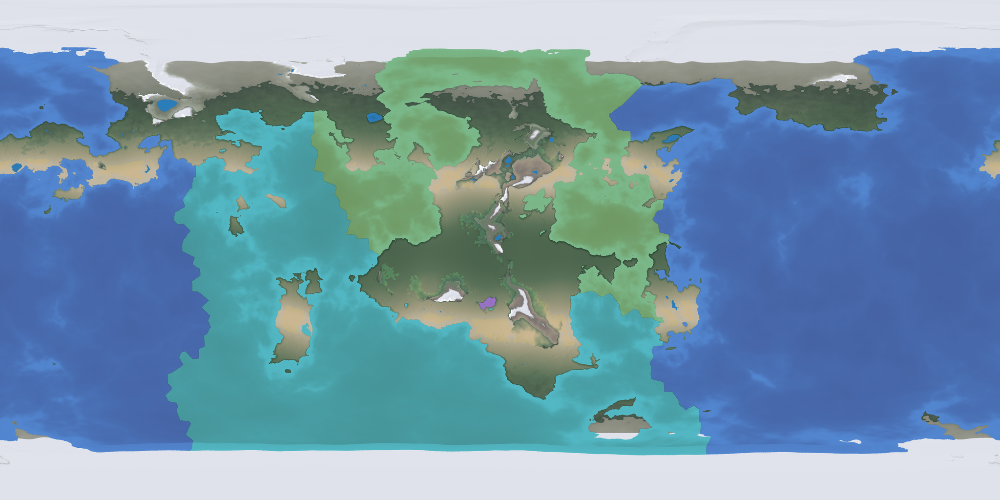](atlas_water_basins.png) |

---

## This world at a glance

| Metric | Value |
| :--- | :--- |
| Surface | **39.4 % land / 60.6 % ocean** |
| Highest peak | **+7 019 m** |
| Median land elevation | **+750 m (90 % of land below +2 050 m)** |
| Median ocean depth | **−3 950 m** |
| Deepest trench | **−10 725 m** |
| Continental shelf (≤ −200 m) | **9.3 % of the ocean** |
| Inhabited provinces | **11 522** (wastelands and polar ice excepted) |
| Civilizations at 1 969 CE | **12 realms · 752 provinces · 47 921 039 people** |

---

## Vertical datum

Terrain maths runs in a normalized heightmap coordinate, but everything the atlas
*reports* is in metres, from one calibrated datum ([`src/core/relief.rs`](src/core/relief.rs)):

| Heightmap | Metres | Reference level |
| :--- | :--- | :--- |
| `1.00` | `+9 000 m` | highest possible peak |
| `0.40` | `0 m` | sea level — the datum |
| `0.00` | `-11 000 m` | deepest possible trench floor |

The scale is piecewise, as on a real hypsometric chart: a heightmap unit is worth ~15 km of
continental relief above the water line and ~27.5 km of abyssal relief below it, so mountains
are not flattened and trenches are not absurd. The raw ocean floor is pushed through an
explicit shelf → slope → abyssal plain → trench transfer pinned at the water line, so it
gains real bathymetry without moving a single coastline.

Both poles are permanently glaciated **land** ([`src/core/polar.rs`](src/core/polar.rs)):
the generator lifts each cap above the water line, so the atlas reports elevation (never
depth) there, and the usual land rules — biomes, wasteland, provinces — apply to it.

---

## Pipeline

1. **Geology & Tectonics** — continental crust and cordilleras evaluated on a 3D unit sphere,
   then hydraulic and thermal erosion passes. Closed off by the permanent polar ice sheets.
2. **Atmosphere & Climate** — ITCZ convection, Hadley-cell downwelling, Coriolis trade winds
   and orographic rain shadows, with an altitude lapse rate read through the datum.
3. **Hydrology** — Barnes Priority-Flood depression resolution, rift lakes, and D8 flow
   accumulation driving dendritic river systems.
4. **Geopolitical Hierarchy (land)** — habitability-weighted province seeding snapping to
   mountain crests, rivers and coasts, clustered into areas → regions → superregions →
   continents. Geography-driven wastelands (desert hearts, high massifs, rainforest interiors,
   polar ice) are impassable, but coastal and river corridors stay settled. Wilderness may
   split a landmass's province network wherever each half keeps a coast of its own — the sea
   joins them — while a populated pocket with no coast is bridged to its landmass's network by
   a short corridor, or reverted to wilderness so it never becomes an island of habitability
   with no path to the sea. Corridors never pierce the polar ice and never run longer than a
   couple of provinces, so no province is ever a thread-thin sliver — and every surviving
   province can follow settled land to water.
5. **Hydro-Political Hierarchy (ocean)** — marine provinces by Poisson-disc seeding plus a
   relaxed Dijkstra flood fill, with bathymetry as a soft barrier, clustered into oceanic
   areas → regions → superregions → continental basins.
6. **Cartography & Rendering** — multi-angle hillshading, an atlas hypsometric palette, and
   the contoured *Topographic* survey sheet, shared verbatim by the headless exporter and the
   interactive viewer so the two can never disagree.
7. **Dawn of History** — the civilizations stage ([`src/civilization/`](src/civilization/)):
   a province census in real km², cradle scoring, a continent-aware handful of rising
   civilizations, fertile-cost expansion over the province graph, population by carrying
   capacity, contact, ancestral stocks and pre-founding inheritance, and a full dossier per
   realm — economy, social order, craft, script, faith, era and population, all dated in the
   world's own Common Era ([`src/civilization/epoch.rs`](src/civilization/epoch.rs)).

---

## The dawn of civilization

The history stage answers one question: **where did people stop being a landscape and start
being a story?**

1. **Census.** Every province is measured once: real ground area in km² (integrated over
   latitude), mean habitability, peak river discharge, mean climate, relief, how much of it
   touches sea or lake, and its carrying capacity in people.
2. **Cradles.** Provinces are scored as potential homes — habitability, a river to irrigate and
   to travel, a shore for fish and salt, gentle ploughable ground — and a continent-aware quota
   picks a well-spread handful of them. Only 5–10 civilizations ever rise, so the world stays a
   wilderness with a few bright corners.
3. **Expansion.** Each cradle floods outward through the province graph cheapest-first: a step
   costs what the terrain between two provinces costs, discounted by how fertile the target is
   and multiplied hard by the length of any jump. That one rule bends frontiers along river
   valleys, stalls them on mountain walls, hops straits to the next island, and stops them dead
   at an older realm's border. The oldest realm always claims first, and a latecomer whose valley
   has already been taken settles the nearest free country instead — and its dossier says so.
4. **Populations.** Every civilized province carries its own population — its carrying capacity
   times its realm's development — so every realm has a total, a density and an area in km².
5. **Contact, ancestry and inheritance.** Realms whose provinces touch share a *land frontier*;
   those across a strait share a *sea route*; those merely within a traveller's reach know each
   other as a *distant rumour*; the rest rose completely alone. Realms that grew out of the same
   stretch of country share an **ancestral stock** — one tongue family, and often one temple form
   and one creed — and a younger realm in contact with an older one may have taken up its crops,
   rites or script *centuries before* founding a city of its own.

### The calendar

There is no calendar to inherit on a planet nobody has inhabited yet, so this world fixes a
convention of its own — and borrows the plainest one there is: years of the **Common Era**,
counted from a single important event in its history. That event is deliberately left
undefined — the atlas never says what happened, only that it mattered — and it is never a
civilization's founding, because a calendar cannot take its epoch from a polity that only
exists because somebody later decided to count years.

Instead the epoch is a **place** and a **year**, and both are drawn from the seed:

- **The place** is one province, chosen from the whole world for the shape a founding
  story takes — a crossroads between realms, a lone peak, a shore, a lake, an island —
  and never a cradle and never a throne. The epoch of a real calendar sits in a marginal
  province of a foreign empire, not in the strongest country of its age, so the site is
  scored for liminality and symbolic charge and *penalised* for being the richest ground
  on the planet. A seeded weighted draw picks among the finest few, so the choice is never
  merely the top score and never arbitrary.
- **The year** follows the place: a few centuries into the life of whoever held it, so the
  site and the date belong to one story. A site in the wilderness — the more usual case
  for a shrine — belongs to nobody, and takes the oldest realm on the world as its anchor.

The timeline has no beginning. Years before the epoch are counted backwards as BCE,
exactly as our own historiography counts them, and the depth of prehistory before the
first city is a separate, far larger quantity: a wide seeded draw biased by how kind the
planet turned out to be, so a gentle world may reach its first hearth in five thousand
years and a harsh or tidally-locked one may take a million. There is no fixed span
between the first people and the first city, and no assumption that a world must have
passed through an ice age to be habitable. The atlas then portrays the world at one date,
a few centuries after the youngest realm began, so every civilization on the map has a
history rather than only a founding.

---

## Usage

```bash
# Generate a new world from a seed and save its cache
cargo run --release -- 3286592765982 --save

# Launch the interactive atlas viewer from cached data
cargo run --release -- 3286592765982 --load --viewer --civs

# Re-render every README plate (all scopes × tiers) from a cached world
cargo run --release -- 3286592765982 --load --plates
```

Every headless run prints the world's hypsometric profile in metres and exports
`world_physical_map.png`, `world_topographic_map.png` (banded elevation survey) and
`world_political_map.png` (land hierarchy). Passing `--civs` wakes the world up: it prints the
civilization dossier to the console and exports `world_civilizations_map.png`, the full 8K
Civilizations plate. The history stage is on automatically with `--viewer` and `--plates`, so the
atlas always has a dawn to show; `--plates` additionally writes the `atlas_*.png` scope and tier
plates used above, straight from the viewer's own painter.