# Project Genesis

A procedural planet generator and interactive atlas viewer written in Rust. It grows an 8K
(8192 × 4096) world from 3D spherical noise, simulates its atmosphere and hydrology,
partitions **both the landmasses and the world ocean** into matching five-tier hierarchies,
then gives that world a history: civilizations rise where the planet is genuinely best,
spread until wilderness, mountains or an older neighbour stops them, and carry a cradle, a
government, a faith and a population of their own.

Every plate below was rendered from one cached world (seed `3286592765982`); a seed always
reproduces the same planet.

[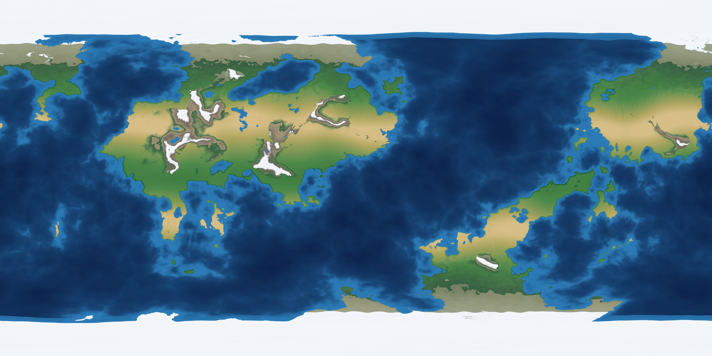](./exports/atlas_physical.png)

## Highlights

- **8K spherical worldgen** — tectonic plates, fractal detail and hydraulic + thermal erosion,
  evaluated as 3D noise on a unit sphere so no seam appears at a pole or the antimeridian.
- **Calibrated in metres** — a piecewise vertical datum, from −10 725 m trenches to +7 019 m
  peaks.
- **Simulated atmosphere and rivers** — ITCZ convection, Hadley-cell downwelling, Coriolis
  trade winds, orographic rain shadows, then flow accumulation into dendritic rivers.
- **Two matching hierarchies** — land and ocean each cut into *Provinces → Areas → Regions →
  Superregions → Continents/Basins*.
- **A dawn of history** — a cradle, a rise story, an economy, a government, a faith, ancestry,
  contacts and real populations for every realm, dated in the world's own era.
- **One painter for both outputs** — the headless exporter and the interactive viewer share
  their cartography, so the printed maps can never disagree with the window.

## Quick start

Requires a Rust toolchain with edition-2024 support (Rust 1.85+). Prebuilt Linux binaries are
attached to the [GitHub releases](https://github.com/Antares6134/Project-Genesis/releases).

```bash
cargo build --release                                          # build
cargo run --release -- 3286592765982 --save                    # generate a world + cache
cargo run --release -- 3286592765982 --load --viewer           # open the interactive atlas
cargo run --release -- 3286592765982 --load --civs             # print the dossier + export it
cargo run --release -- 3286592765982 --load --plates           # re-render every README plate
```

| Flag | Effect |
| :--- | :--- |
| `<seed>` | Any unsigned integer; the same seed always produces the same planet. |
| `--save` | Write the generated world to `world_<seed>.bin`. |
| `--load` | Reuse `world_<seed>.bin` instead of regenerating (much faster). |
| `--viewer` | Launch the interactive desktop atlas. |
| `--civs` | Run the history stage, print the dossier, export its 8K plate. |
| `--civs-all` | The same, with a full dossier for every society — hundreds of them. |
| `--plates` | Export the 17 `./exports/atlas_*.png` scope and tier plates used below. |

Every headless run also exports `world_physical_map.png`, `world_topographic_map.png` (a
contoured elevation survey) and `world_political_map.png` (the land hierarchy). The history
stage runs automatically with `--viewer` and `--plates`, so the atlas always has a dawn to show.

## Atlas gallery

Nine map scopes, each with its own legend; the **Civilizations overlay** checkbox tints the
provinces each society holds on top of *any* scope.

| Scope | What it portrays |
| :--- | :--- |
| **🗺 Physical** | Pure relief: hillshaded hypsometric palette, biomes, rivers and ice. No politics. |
| **⛰ Topographic** | A survey sheet: colour *is* elevation, contoured at every band boundary, with metre readouts on hover. |
| **🌦 Climate** | Climate zones: land by mean temperature, rainfall and altitude; sea by surface temperature. |
| **🌡 Temperature** | Thermal belts, from deep violet cold to red-hot tropics, with a thin line on every 5 °C isotherm. |
| **🪨 Terrain** | Landform and bathymetry classes: abyssal plain, shelf, coastal lowland, hill country, upland, mountain and high mountain. |
| **🏺 Civilizations** | The dawn of history: the physical world with the realms that rose on it, each in its own colour, with a dot on the cradle province where it began. |
| **🏛 Land** | Political subdivision of the landmasses only; the ocean stays plain water. |
| **🌊 Water** | The hydro-political subdivision of the world ocean only; the continents are muted. |
| **🌍 Everywhere** | Both hierarchies portrayed at once. |

| 🗺 Physical | ⛰ Topographic | 🌦 Climate |
| :---: | :---: | :---: |
| [](./exports/atlas_physical.png) | [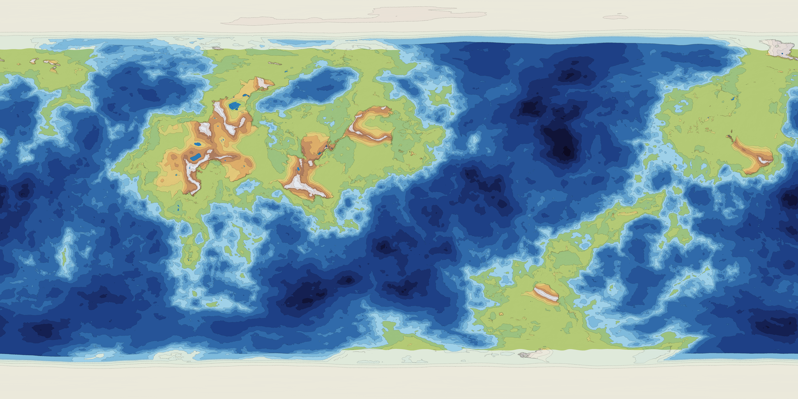](./exports/atlas_topographic.png) | [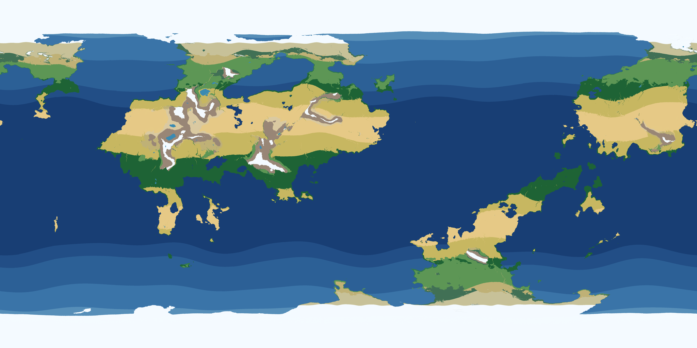](./exports/atlas_climate.png) |

| 🌡 Temperature | 🪨 Terrain | 🏺 Civilizations |
| :---: | :---: | :---: |
| [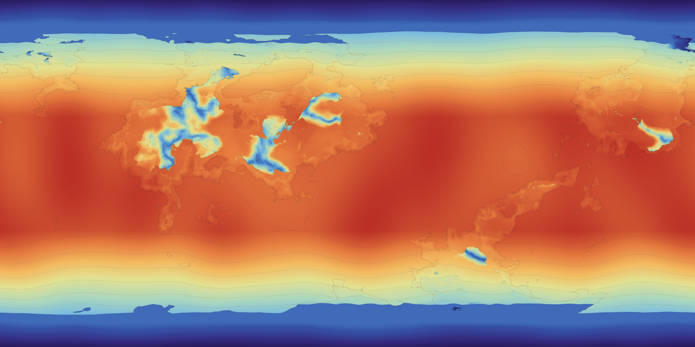](./exports/atlas_temperature.png) | [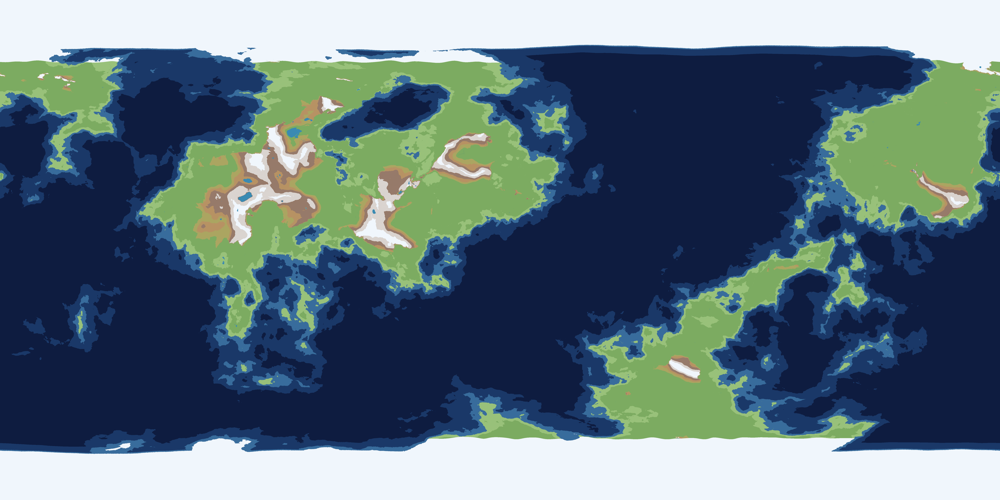](./exports/atlas_terrain.png) | [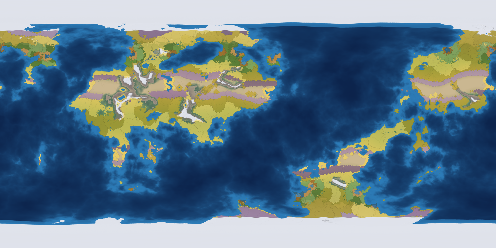](./exports/atlas_civilizations.png) |

| 🏛 Land | 🌊 Water | 🌍 Everywhere |
| :---: | :---: | :---: |
| [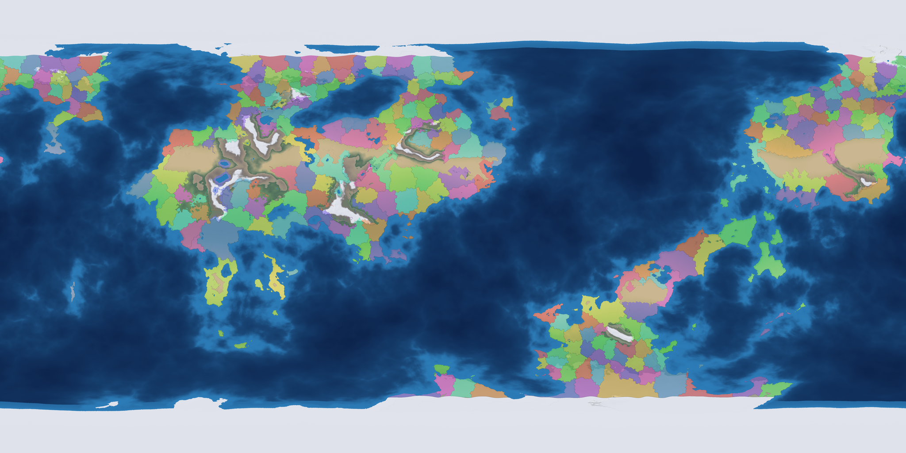](./exports/atlas_land_regions.png) | [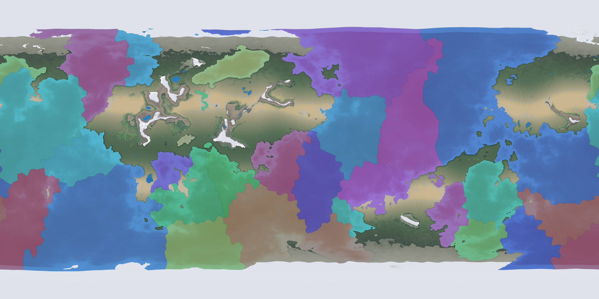](./exports/atlas_water_regions.png) | [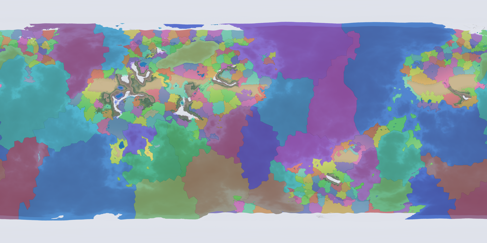](./exports/atlas_everywhere_regions.png) |

### Land tiers

**Province → Area → Region → Superregion → Continent.** Each tier is a pure reaggregation of
the one below it, so switching tiers never moves a border — it only coarsens the palette.

| Provinces | Areas | Regions | Superregions | Continents |
| :---: | :---: | :---: | :---: | :---: |
| [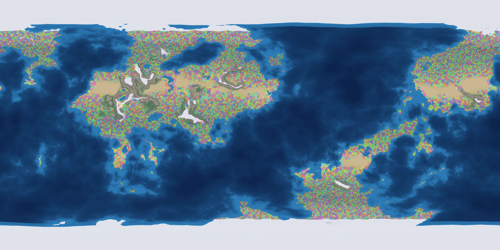](./exports/atlas_land_provinces.png) | [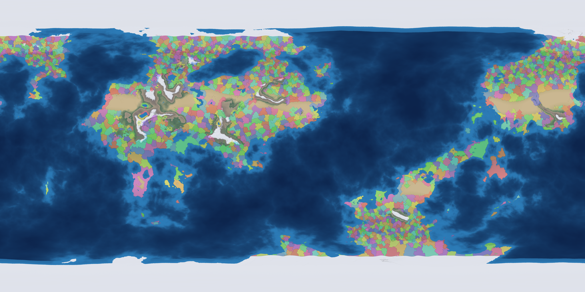](./exports/atlas_land_areas.png) | [](./exports/atlas_land_regions.png) | [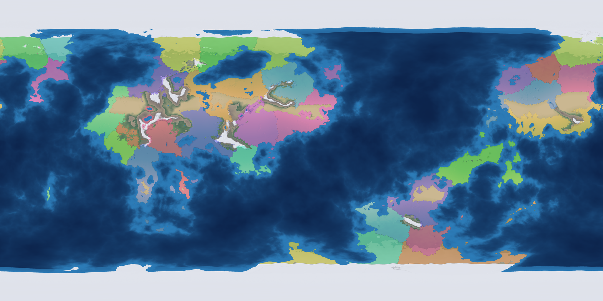](./exports/atlas_land_superregions.png) | [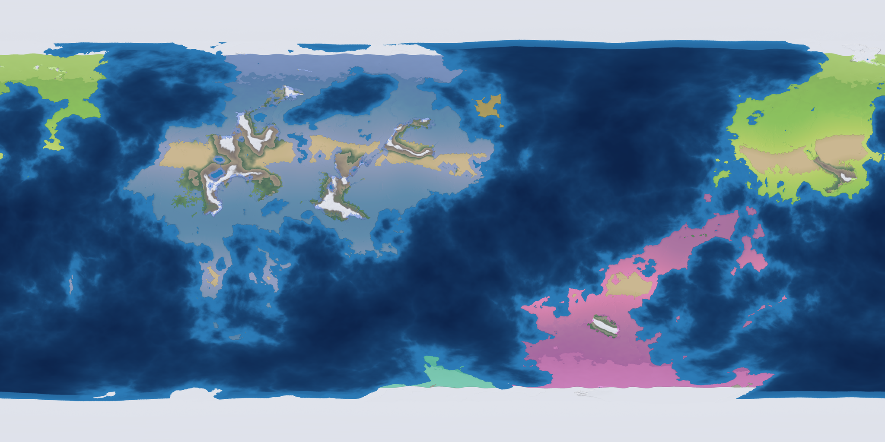](./exports/atlas_land_continents.png) |

### Ocean tiers

The world ocean — open water **and** the frozen polar seas — mirrors the same five tiers,
scaled up because it is one connected, far larger domain.

| Marine provinces | Oceanic areas | Oceanic regions | Oceanic superregions | Continental basins |
| :---: | :---: | :---: | :---: | :---: |
| [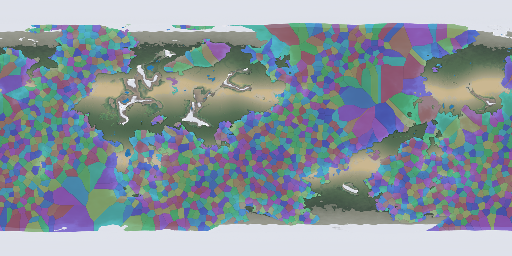](./exports/atlas_water_provinces.png) | [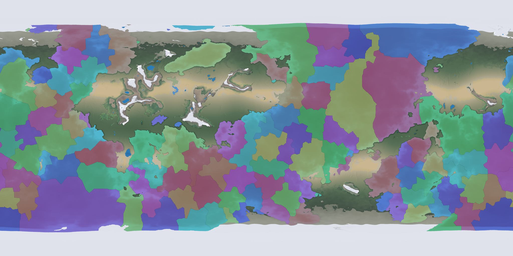](./exports/atlas_water_areas.png) | [](./exports/atlas_water_regions.png) | [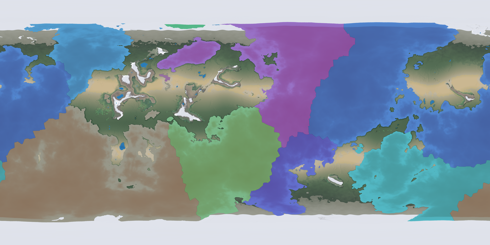](./exports/atlas_water_superregions.png) | [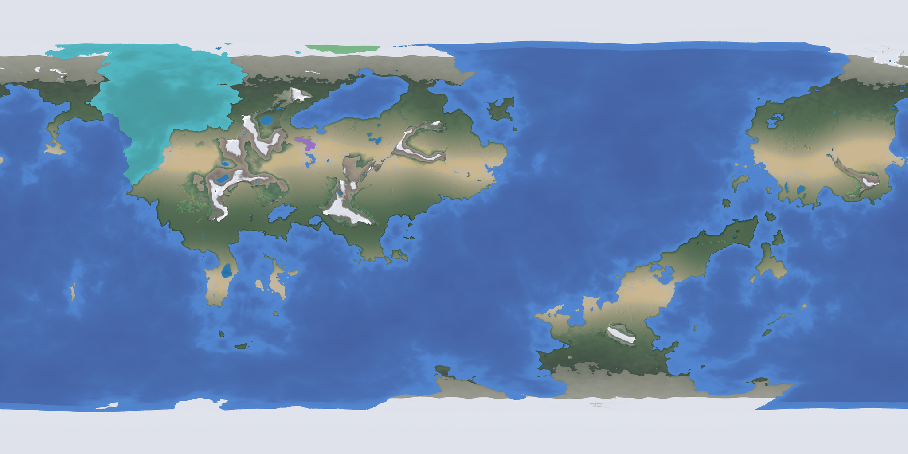](./exports/atlas_water_basins.png) |

## This world at a glance

| Metric | Value |
| :--- | :--- |
| Surface | **39.4 % land / 60.6 % ocean** |
| Land hierarchy | **10 864 provinces · 1 349 areas · 246 regions · 36 superregions · 7 continents** |
| Ocean hierarchy | **1 974 provinces · 135 areas · 36 regions · 11 superregions · 4 basins** |
| Highest peak / deepest trench | **+7 019 m / −10 725 m** |
| Median land elevation | **+750 m** (90 % of land below +2 050 m) |
| Median ocean depth | **−3 950 m** |
| Continental shelf (≤ −200 m) | **9.3 % of the ocean** |
| Civilizations at 4 190 CE | **24 realms · 790 provinces · 46 201 249 people** |

## How it works

1. **Terrain** — plates, fractal detail and hydraulic + thermal erosion, evaluated as 3D noise
   on a unit sphere, then sealed under permanent polar ice ([`src/terrain/`](src/terrain/),
   [`src/core/polar.rs`](src/core/polar.rs)).
2. **Climate** — ITCZ convection, Hadley-cell downwelling, Coriolis trade winds and
   orographic rain shadows, with an altitude lapse rate ([`src/climate/`](src/climate/)).
3. **Hydrology** — Barnes Priority-Flood depression filling, rift lakes and D8 flow
   accumulation into dendritic rivers ([`src/hydrology/`](src/hydrology/)).
4. **Land provinces** — habitability-weighted seeding snapped to mountain crests, rivers and
   coasts. Geography-driven wastelands (desert hearts, high massifs, rainforest interiors,
   polar ice) are impassable, but corridors and the sea leave every settled province a path to
   water ([`src/geography/provinces.rs`](src/geography/provinces.rs)).
5. **Ocean provinces** — Poisson-disc seeding plus a bathymetry-aware Dijkstra flood fill,
   across open **and** frozen seas ([`src/geography/oceans.rs`](src/geography/oceans.rs)).
6. **Hierarchies** — each domain clustered upward: Areas → Regions → Superregions →
   Continents (land) and Areas → Regions → Superregions → Basins (ocean)
   ([`src/geopolitics/`](src/geopolitics/)).
7. **History** — census, cradle scoring, expansion, deep-time development, populations,
   contact and inheritance ([`src/civilization/`](src/civilization/)).

Terrain maths runs in a normalized heightmap coordinate, but everything the atlas *reports* is
in metres from one piecewise datum ([`src/core/relief.rs`](src/core/relief.rs)) — `1.0` =
+9 000 m, `0.4` = 0 m (sea level), `0.0` = −11 000 m — so mountains are not flattened and
trenches are not absurd. Both poles are permanently glaciated **land**, so the atlas reports
elevation there rather than depth, and the usual land rules apply to it.

## The dawn of history

The dawn does not leave a wilderness around a handful of clearings: it **partitions the whole
inhabited world**. Every province belongs to somebody: a state, a chiefdom, a farming village,
a herd people or a band of foragers.

**What the country can feed.** Every province is read for its own country: a biome, and how well
it would carry a field or a herd. This half of the model knows nothing about states, a floodplain
is farmable whether or not anyone has reached it yet.

**How far that has spread.** One queue, seeded at every cradle at once, grows all the states
together and leaves behind a cost field: how far every province lies from the nearest state, and
which state that is. A step costs the terrain it crosses, discounted by the target's fertility
and multiplied by the length of any jump, so the field bends along river valleys, stalls on
mountain walls and hops straits — and farming spreads outward from the people who invented it
rather than appearing wherever rain allows.

**The five-way scheme.** The two halves meet: ground that can be farmed *and* lies within reach of
a state is farmed, ranked or ruled; ground that can be farmed but lies beyond that reach is still
wild; dry grass carries herds; everything else is hunted. A fertile country nobody reached may
rise on its own account, as the Amazon and New Guinea did. The result is a mosaic of

*Hunter-gatherers → Nomadic pastoralists → Simple farming societies → Complex farming societies
→ State societies*

roughly 67 / 8 / 16 / 5 / 2 per cent of the inhabited world, close to what a real map of 2000 BCE
shows. Each tier decides a society's colour, how many people each province feeds, and what the
atlas calls it ([`src/civilization/mod.rs`](src/civilization/mod.rs)).

**Government and people.** Every society has one government, from band to tribe to chiefdom, and —
once it is a state — a regime chosen from its economy and ethos (a divine monarch or temple
republic for a river people, merchants or a landed elite for a boat people, a tyrant or a clique
for a herd people). Only states climb the development axis toward the atlas date; a band of
foragers is not a less-developed state but a different kind of society, and its place on the axis
is set by its tier. Societies in contact share a land frontier, a sea route or a distant rumour;
those grown from the same country share an ancestral stock, a tongue family and often a creed.

**The world's age.** The age belongs to the world and its date, never to a society:
*Cultivation → Irrigation → Copper & Alloys → Refinement → Architecture → Automated Mills →
Oceanic Currents → Industrial → Information → Molecular → Planetary*. This build simulates to
**Copper & Alloys**, so the later ages complete the ladder rather than being reached
([`src/civilization/age.rs`](src/civilization/age.rs)).

**The calendar.** Years of the **Common Era**, counted from a single deliberately undefined
event. The epoch is a seeded *place* and *year*: a province chosen for the shape a founding
story takes — a crossroads, a lone peak, a shore, a lake, an island, never a cradle and never
a throne — and a year placed a few centuries to a couple of millennia *after* the atlas date.
Because the map portrays the world in its dawn, every date it shows is therefore counted back
as BCE, and the depth of prehistory before the first
city is a separate, far larger quantity biased by how kind the planet turned out to be
([`src/civilization/epoch.rs`](src/civilization/epoch.rs)).

## Determinism and caching

Everything is drawn from the seed through a `ChaCha8Rng` with fixed per-stage salts, and every
collection the RNG walks is sorted, so a seed always yields the same planet, civilizations,
dates and populations. `--save` caches the physical layers (heightmap, temperature,
precipitation, flow, lakes) in `world_<seed>.bin`; `--load` reuses it and reruns only the
political and history stages.

## Project layout

| Path | Contents |
| :--- | :--- |
| [`src/core/`](src/core/) | Grid, spherical geometry, the vertical datum, polar ice, the binary world cache. |
| [`src/terrain/`](src/terrain/) | Tectonics, fractal detail, hydraulic and thermal erosion. |
| [`src/climate/`](src/climate/) | Wind cells, temperature and moisture. |
| [`src/hydrology/`](src/hydrology/) | Depression fill, lake finding, water flow and rivers. |
| [`src/geography/`](src/geography/) | Land and ocean province generation. |
| [`src/geopolitics/`](src/geopolitics/) | Province graph extraction and the five-tier hierarchies. |
| [`src/civilization/`](src/civilization/) | Cradles, expansion, development, ages, the calendar, dossiers. |
| [`src/export/`](src/export/) | Palettes, legends and the headless PNG painters. |
| [`src/viewer/`](src/viewer/) | The interactive egui atlas: scopes, tiers, legends and hover readouts. |
| [`src/main.rs`](src/main.rs) | CLI parsing and the render stages, headless or interactive. |

Built with Rust (edition 2024) and a small dependency set: `eframe`/`egui`, `noise`,
`rand_chacha`, `rayon`, `bincode`, `image` and `serde`.

---

Every plate above is produced by `--plates` from seed `3286592765982`; the 8K `world_*.png`
maps are exported by every headless run.
