# Project Genesis

A procedural planet generator and interactive atlas viewer written in Rust. It grows an 8K
(8192 × 4096) world from 3D spherical noise, simulates its atmosphere and hydrology,
partitions **both the landmasses and the world ocean** into matching five-tier hierarchies,
then gives that world a history: civilizations rise where the planet is genuinely best,
spread until wilderness, mountains or an older neighbour stops them, and carry a cradle, a
government, a faith and a population of their own.

Every plate below was rendered from one cached world (seed `3286592765982`); a seed always
reproduces the same planet.

[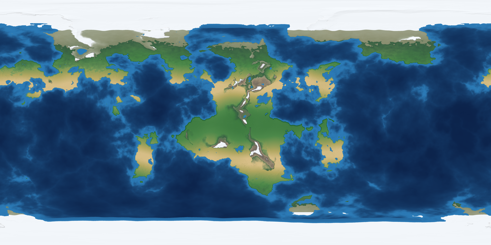](./exports/atlas_physical.png)

## Highlights

- **8K spherical worldgen** — tectonic plates, fractal detail and hydraulic + thermal erosion,
  evaluated as 3D noise on a unit sphere so no seam appears at a pole or the antimeridian.
- **Calibrated in metres** — a piecewise vertical datum, from −10 725 m trenches to +7 019 m
  peaks.
- **Simulated atmosphere and rivers** — ITCZ convection, Hadley-cell downwelling, Coriolis
  trade winds, orographic rain shadows, then flow accumulation into dendritic rivers.
- **Two matching hierarchies** — land and ocean each cut into *Provinces → Areas → Regions →
  Superregions → Continents/Basins*.
- **A dawn of history** — a cradle, a rise story, an economy, a government, a faith, ancestry,
  contacts and real populations for every realm, dated in the world's own era.
- **One painter for both outputs** — the headless exporter and the interactive viewer share
  their cartography, so the printed maps can never disagree with the window.

## Quick start

Requires a Rust toolchain with edition-2024 support (Rust 1.85+). Prebuilt Linux binaries are
attached to the [GitHub releases](https://github.com/Antares6134/Project-Genesis/releases).

```bash
cargo build --release                                          # build
cargo run --release -- --viewer                                # open the atlas and grow a world in it
cargo run --release -- 3286592765982 --save                    # generate a world headlessly + cache
cargo run --release -- 3286592765982 --load --civs             # print the dossier + export it
cargo run --release -- 3286592765982 --load --plates           # re-render every README plate
```

The atlas opens **before** any world exists. Give it a seed (or draw one), and the eight acts of
creation are buttons in its genesis panel — each one runs on a worker thread, in order, with a
live low-resolution plate of the world appearing on the canvas as it is made.

| Flag | Effect |
| :--- | :--- |
| `<seed>` | Any unsigned integer; the same seed always produces the same planet. |
| `--save` | Write the world as it grows (acts 1–3, then 1–6) to `saved_seeds/world_<seed>.bin`, zstd-compressed on disk. |
| `--load` | Adopt the saved world for the seed instead of regenerating (much faster): the acts the file carries are taken as done, and the act after them is offered next. |
| `--viewer` | Launch the interactive desktop atlas. |
| `--civs` | Run the history stage, print the dossier, export its 8K plate. |
| `--civs-all` | The same, with a full dossier for every society — hundreds of them. |
| `--langs` | Run Act 8, print the language families and their lexicons, and export the Languages map. |
| `--plates` | Export the 17 `./exports/atlas_*.png` scope and tier plates used below. |

The world cache is a single file, `saved_seeds/world_<seed>.bin`, holding whichever acts the world
had grown when it was written — every save overwrites the last, so it always holds the deepest one.
It is written as a zstd frame — a `PGZ2` magic, one byte naming the deepest act held, then the same
bincode payload an uncompressed cache holds — so a save is a good deal smaller than its raw bytes.
The one-byte header lets the atlas say how far a save was grown without decoding it, and is a hint
only: a load still reads the acts off the payload. Compression is lossless, so a reloaded world is
bit-for-bit the world that was saved, and a cache written by an older build (`PGZ1`, or bare bincode
with no magic) still loads.

Every headless run also exports `world_physical_map.png`, `world_topographic_map.png` (a
contoured elevation survey) and `world_political_map.png` (the land hierarchy). `--civs` and
`--plates` run the history stage too, since a world plate wants a dawn on it.

### Growing a world in the atlas

`--viewer` opens the window first and grows nothing until it is asked. The genesis panel on the
left is the whole pipeline:

| Step | What it does |
| :--- | :--- |
| **Seed** | Type a whole number, or press 🎲 to draw one. A seed is read by each act as it runs, so changing it between acts keeps the acts already grown and re-points only the acts still to come; before act 1 it simply starts a fresh world. |
| **World data** | 📂 **Load** and 💾 **Save** are the two commands for the seed above. **Save** writes the world as it stands to `saved_seeds/world_<seed>.bin`, from act 1 up to act 6 — the land, the climate, the water and as far up the hierarchies as the world has climbed; acts 7 and 8 are never written. Every save overwrites the last, so the file always holds the deepest checkpoint. **Load** adopts it in one press and picks the panel up at the act after the one it holds. 💾 **Save automatically when act 3 and act 6 land** is the setting behind them: while it is ticked, act 3 writes the cache and act 6 writes it again, overwriting the earlier save. The expandable **📂 Saved worlds** list under it shows every cache on disk, newest first, with its age and size, and each row names the acts that save holds — `acts 1–6` — read from the file's one-byte header (a save from an older build, which has no header, says only that a world is there); click a world to load it. A seed with no cache says so, and says what would put one there. |
| **The eight acts** | Only the next act is pressable; the ones behind it are ✔ and the ones ahead are greyed out. Every ✔ act also carries a small **↺** button that un-does that act and everything after it, so the whole tail may be grown again — optionally from a new seed typed above. |
| **▶▶ Run all remaining** | Grows the rest of the world without stopping (⏹ stops it after the act in flight). |
| **↺ Reset world** | Throws the world away and starts over on the same seed. |

| Act | What it makes |
| :--- | :--- |
| 1. Geology & Erosion | Tectonic plates, fractal detail, hydraulic + thermal erosion |
| 2. Atmospheric Climate | Temperature, winds, rainfall |
| 3. Hydrology & Rivers | Lakes and flow accumulation — **the world cache is written here, and again at act 6** |
| 4. Geography & Provinces | The land cut into provinces, its wilderness mapped |
| 5. Geopolitical Hierarchy | Provinces → areas → regions → superregions → continents |
| 6. Hydro-Political Hierarchy | The world ocean, same five tiers — **the full pre-history checkpoint (acts 1–6) is writable from here** |
| 7. Dawn of Civilization | Realms, societies, populations, an era |
| 8. Languages & Phonetics | Phonologies, proto-lexicons, Urheimats, native names |

Each act runs on a worker thread, so the window stays alive while the world is grown, and the
map scopes are offered exactly when their subject exists: the survey sheet from act 1, the
physical atlas and both climate scopes from act 2, the political map from act 4, the ocean and
the dawn from acts 6 and 7. While an act runs, the canvas shows a **live plate** — a
low-resolution picture painted from the very grid the act is working on, a few frames a second:
continents assembling, valleys carving, lakes filling, rivers reaching the sea, provinces
spreading outward, realms claiming their hinterlands. When the act lands, its full 8K plate
replaces it in place.

Nothing else changed: a world grown from one seed throughout still grows exactly the same planet
(change the seed part-way and the acts still to come grow from the new one), and a world adopted
from a cache is identical to one grown from scratch.

## Atlas gallery

Ten map scopes, each with its own legend; the **Civilizations overlay** checkbox tints the
provinces each society holds on top of *any* scope.

| Scope | What it portrays |
| :--- | :--- |
| **🗺 Physical** | Pure relief: hillshaded hypsometric palette, biomes, rivers and ice. No politics. |
| **⛰ Topographic** | A survey sheet: colour *is* elevation, contoured at every band boundary, with metre readouts on hover. |
| **🌦 Climate** | Climate zones: land by mean temperature, rainfall and altitude; sea by surface temperature. |
| **🌡 Temperature** | Thermal belts, from deep violet cold to red-hot tropics, with a thin line on every 5 °C isotherm. |
| **🪨 Terrain** | Landform and bathymetry classes: abyssal plain, shelf, coastal lowland, hill country, upland, mountain and high mountain. |
| **🏺 Civilizations** | The dawn of history: the physical world with the realms that rose on it, each in its own colour, with a dot on the cradle province where it began. |
| **🗣 Languages** | The world's language families: one colour per family, one shade per language, with an Urheimat and a native autonym for every tongue. |
| **🏛 Land** | Political subdivision of the landmasses only; the ocean stays plain water. |
| **🌊 Water** | The hydro-political subdivision of the world ocean only; the continents are muted. |
| **🌍 Everywhere** | Both hierarchies portrayed at once. |

| 🗺 Physical | ⛰ Topographic | 🌦 Climate |
| :---: | :---: | :---: |
| [](./exports/atlas_physical.png) | [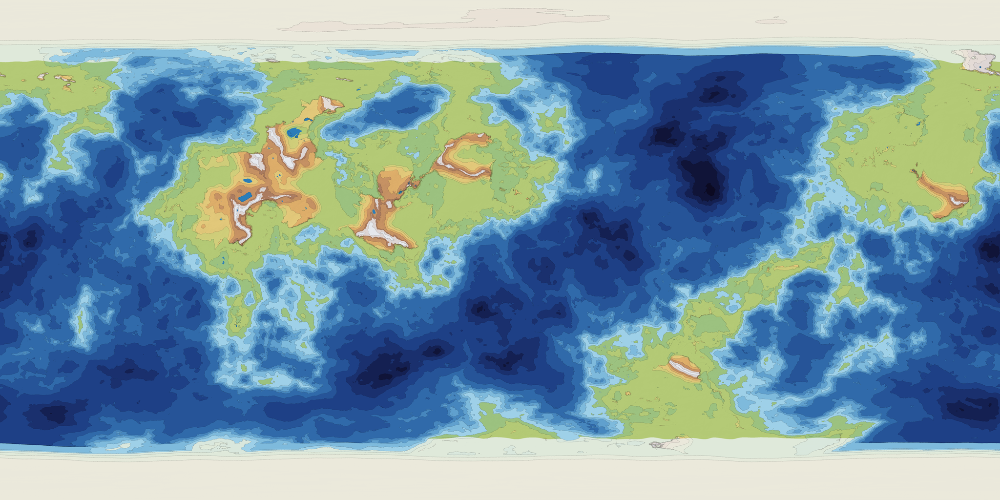](./exports/atlas_topographic.png) | [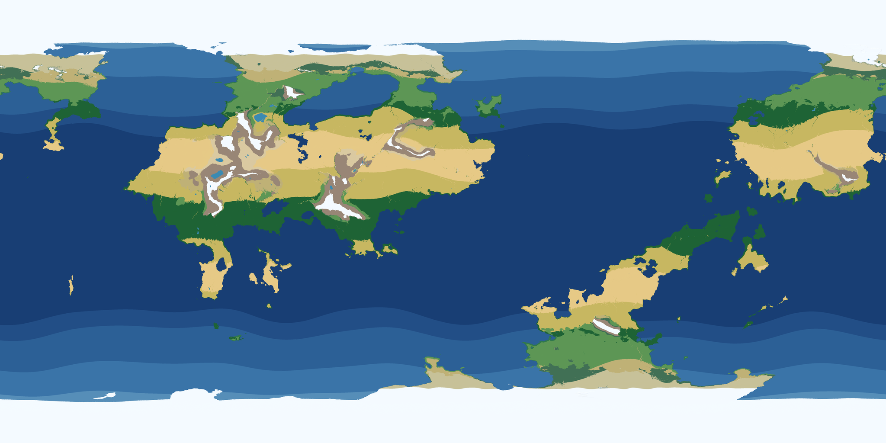](./exports/atlas_climate.png) |

| 🌡 Temperature | 🪨 Terrain | 🏺 Civilizations |
| :---: | :---: | :---: |
| [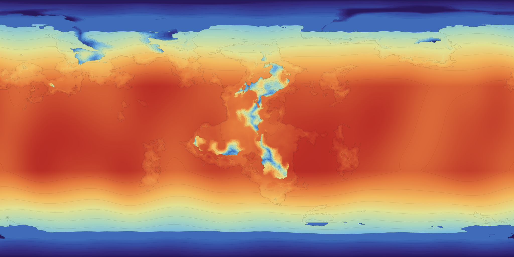](./exports/atlas_temperature.png) | [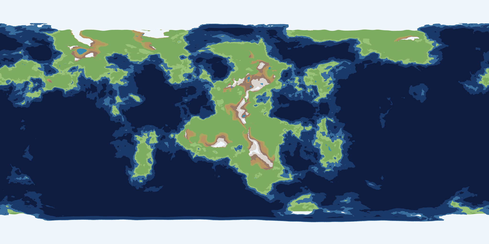](./exports/atlas_terrain.png) | [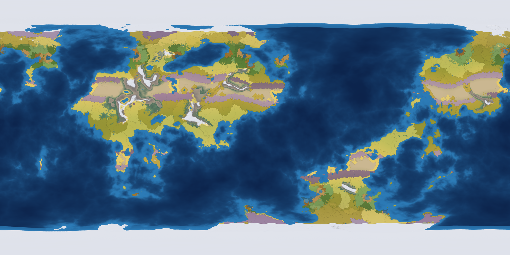](./exports/atlas_civilizations.png) |

| 🏛 Land | 🌊 Water | 🌍 Everywhere |
| :---: | :---: | :---: |
| [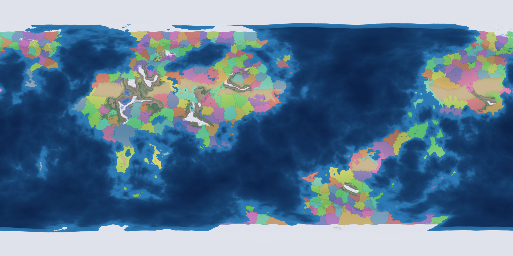](./exports/atlas_land_regions.png) | [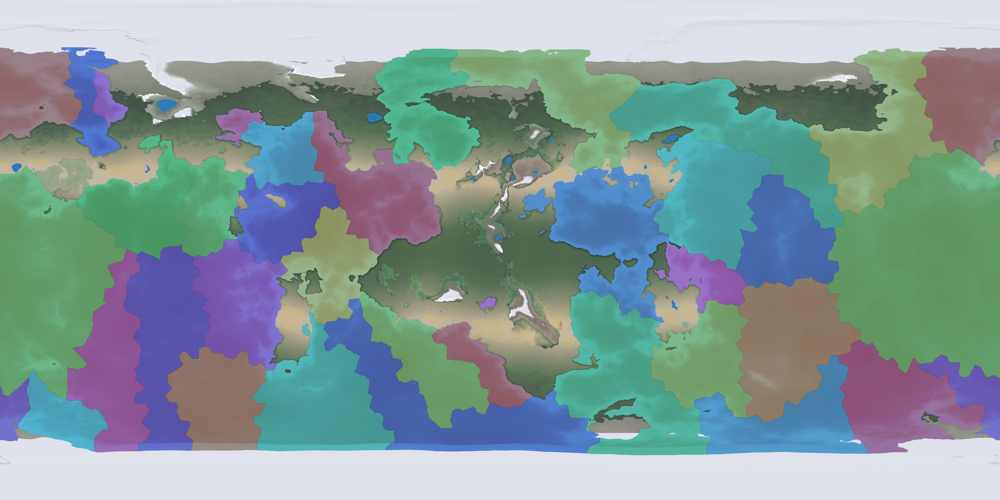](./exports/atlas_water_regions.png) | [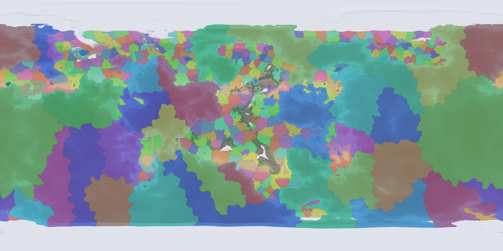](./exports/atlas_everywhere_regions.png) |

### Languages & Phonetics

Act 8 gives the world a voice. Ten to eighteen ancestral families are placed at
*Urheimats* — river basins, coasts, lakeshores, temperate woodlands and isolated
high valleys — and each draws a **phonology DNA** from its country: a consonant
and vowel inventory, syllable templates (`CV`, `CVC`, `CCVC`…), sonority-based
phonotactic rules, and marked articulations such as glottal stops (`'`). Every
family then names the same forty core meanings in its own sounds, and compounds
those roots into language names, autonyms, realms, capitals and homelands.

The families spread across the province graph by a friction-weighted flood fill:
rivers and open plains are cheap, hills cost more, mountain spines and deep
wilderness cost most, and open ocean is a wall until the world can sail. Dense
urban cradles split into local daughter languages and isolates, while pastoral and
wilderness zones form sweeping macro-family blobs. Stage 8 republishes the
civilizations with native names, so the Civilizations legend and hover cards pick
them up without a special case.

The Languages map mode paints every province by the tongue it speaks, the legend
lists each family's autonym, archetype, Urheimat and languages, and hovering a
province or realm shows its family, language, native name and homeland. Languages
are cheap to generate — a fraction of a second — so they are not cached: a loaded
world grows its tongues afresh rather than reading them back.

### Land tiers

**Province → Area → Region → Superregion → Continent.** Each tier is a pure reaggregation of
the one below it, so switching tiers never moves a border — it only coarsens the palette.

| Provinces | Areas | Regions | Superregions | Continents |
| :---: | :---: | :---: | :---: | :---: |
| [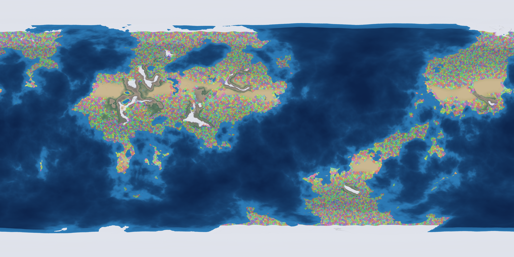](./exports/atlas_land_provinces.png) | [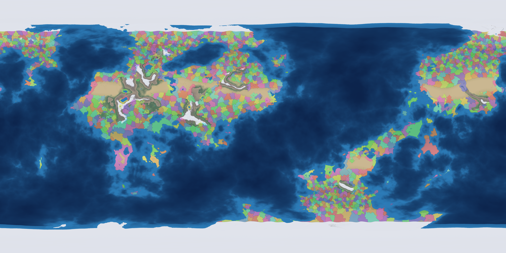](./exports/atlas_land_areas.png) | [](./exports/atlas_land_regions.png) | [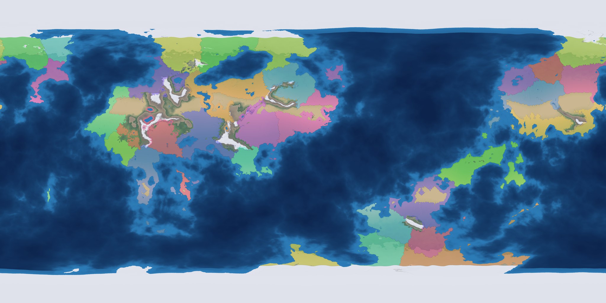](./exports/atlas_land_superregions.png) | [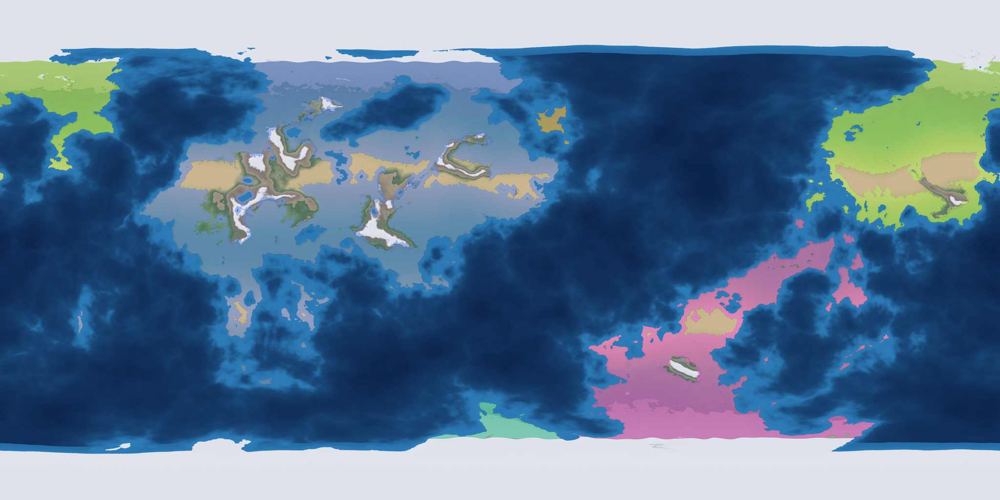](./exports/atlas_land_continents.png) |

### Ocean tiers

The world ocean — open water **and** the frozen polar seas — mirrors the same five tiers,
scaled up because it is one connected, far larger domain.

| Marine provinces | Oceanic areas | Oceanic regions | Oceanic superregions | Continental basins |
| :---: | :---: | :---: | :---: | :---: |
| [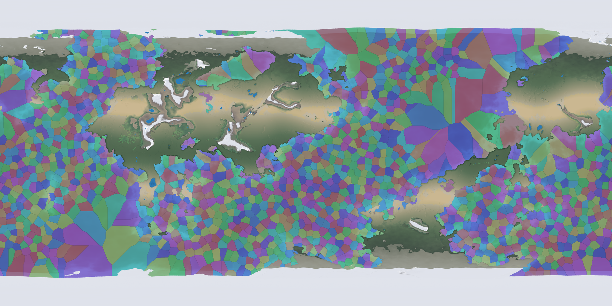](./exports/atlas_water_provinces.png) | [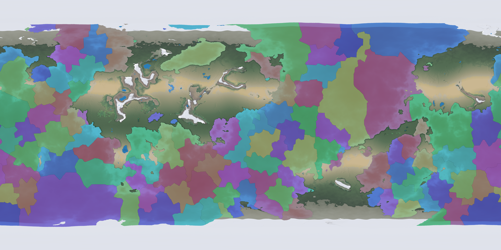](./exports/atlas_water_areas.png) | [](./exports/atlas_water_regions.png) | [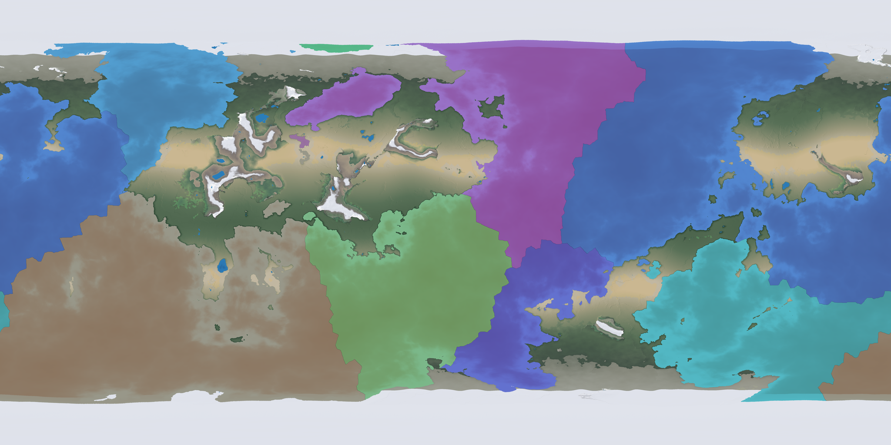](./exports/atlas_water_superregions.png) | [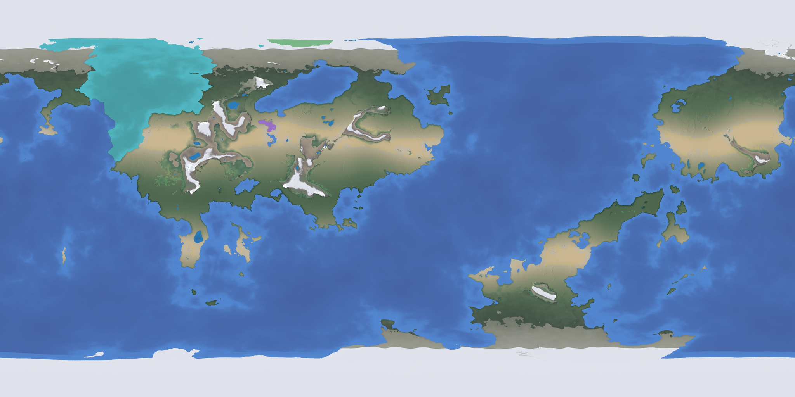](./exports/atlas_water_basins.png) |

## This world at a glance

| Metric | Value |
| :--- | :--- |
| Surface | **39.4 % land / 60.6 % ocean** |
| Land hierarchy | **10 864 provinces · 1 349 areas · 246 regions · 36 superregions · 7 continents** |
| Ocean hierarchy | **1 776 provinces · 135 areas · 36 regions · 11 superregions · 4 basins** |
| Highest peak / deepest trench | **+7 019 m / −10 725 m** |
| Median land elevation | **+750 m** (90 % of land below +2 050 m) |
| Median ocean depth | **−3 950 m** |
| Continental shelf (≤ −200 m) | **9.3 % of the ocean** |
| Civilizations at 2 160 BCE | **24 states · 21 474 884 world population · 0.23 people/km²** |

## How it works

1. **Terrain** — plates, fractal detail and hydraulic + thermal erosion, evaluated as 3D noise
   on a unit sphere, then sealed under permanent polar ice ([`src/terrain/`](src/terrain/),
   [`src/core/polar.rs`](src/core/polar.rs)).
2. **Climate** — ITCZ convection, Hadley-cell downwelling, Coriolis trade winds and
   orographic rain shadows, with an altitude lapse rate ([`src/climate/`](src/climate/)).
3. **Hydrology** — Barnes Priority-Flood depression filling, rift lakes and D8 flow
   accumulation into dendritic rivers ([`src/hydrology/`](src/hydrology/)).
4. **Land provinces** — habitability-weighted seeding snapped to mountain crests, rivers and
   coasts. Geography-driven wastelands (desert hearts, high massifs, rainforest interiors,
   polar ice) are impassable, but corridors and the sea leave every settled province a path to
   water ([`src/geography/provinces.rs`](src/geography/provinces.rs)).
5. **Ocean provinces** — Poisson-disc seeding plus a bathymetry-aware Dijkstra flood fill,
   across open **and** frozen seas ([`src/geography/oceans.rs`](src/geography/oceans.rs)).
6. **Hierarchies** — each domain clustered upward: Areas → Regions → Superregions →
   Continents (land) and Areas → Regions → Superregions → Basins (ocean)
   ([`src/geopolitics/`](src/geopolitics/)).
7. **History** — census, cradle scoring, expansion, deep-time development, populations,
   contact and inheritance ([`src/civilization/`](src/civilization/)).

Terrain maths runs in a normalized heightmap coordinate, but everything the atlas *reports* is
in metres from one piecewise datum ([`src/core/relief.rs`](src/core/relief.rs)) — `1.0` =
+9 000 m, `0.4` = 0 m (sea level), `0.0` = −11 000 m — so mountains are not flattened and
trenches are not absurd. Both poles are permanently glaciated **land**, so the atlas reports
elevation there rather than depth, and the usual land rules apply to it.

## The dawn of history

The dawn does not leave a wilderness around a handful of clearings: it **partitions the whole
inhabited world**. Every province belongs to somebody: a state, a chiefdom, a farming village,
a herd people or a band of foragers.

**What the country can feed.** Every province is read for its own country: a biome, and how well
it would carry a field or a herd. This half of the model knows nothing about states, a floodplain
is farmable whether or not anyone has reached it yet.

**How far that has spread.** One queue, seeded at every cradle at once, grows all the states
together and leaves behind a cost field: how far every province lies from the nearest state, and
which state that is. A step costs the terrain it crosses, discounted by the target's fertility
and multiplied by the length of any jump, so the field bends along river valleys, stalls on
mountain walls and hops straits — and farming spreads outward from the people who invented it
rather than appearing wherever rain allows.

**The five-way scheme.** The two halves meet: ground that can be farmed *and* lies within reach of
a state is farmed, ranked or ruled; ground that can be farmed but lies beyond that reach is still
wild; dry grass carries herds; everything else is hunted. A fertile country nobody reached may
rise on its own account, as the Amazon and New Guinea did. The result is a mosaic of

*Hunter-gatherers → Nomadic pastoralists → Simple farming societies → Complex farming societies
→ State societies*

roughly 67 / 8 / 16 / 5 / 2 per cent of the inhabited world, close to what a real map of 2000 BCE
shows. Each tier decides a society's colour, how many people each province feeds, and what the
atlas calls it ([`src/civilization/mod.rs`](src/civilization/mod.rs)).

**Government and people.** Every society has one government, from band to tribe to chiefdom, and —
once it is a state — a regime chosen from its economy and ethos (a divine monarch or temple
republic for a river people, merchants or a landed elite for a boat people, a tyrant or a clique
for a herd people). Only states climb the development axis toward the atlas date; a band of
foragers is not a less-developed state but a different kind of society, and its place on the axis
is set by its tier. Societies in contact share a land frontier, a sea route or a distant rumour;
those grown from the same country share an ancestral stock, a tongue family and often a creed.

**The world's age.** The age belongs to the world and its date, never to a society:
*Cultivation → Irrigation → Copper & Alloys → Refinement → Architecture → Automated Mills →
Oceanic Currents → Industrial → Information → Molecular → Planetary*. This build simulates to
**Copper & Alloys**, so the later ages complete the ladder rather than being reached
([`src/civilization/age.rs`](src/civilization/age.rs)).

**The calendar.** Years of the **Common Era**, counted from a single deliberately undefined
event. The epoch is a seeded *place* and *year*: a province chosen for the shape a founding
story takes — a crossroads, a lone peak, a shore, a lake, an island, never a cradle and never
a throne — and a year placed a few centuries to a couple of millennia *after* the atlas date.
Because the map portrays the world in its dawn, every date it shows is therefore counted back
as BCE, and the depth of prehistory before the first
city is a separate, far larger quantity biased by how kind the planet turned out to be
([`src/civilization/epoch.rs`](src/civilization/epoch.rs)).

## Determinism and caching

Everything is drawn from the seed through a `ChaCha8Rng` with fixed per-stage salts, and every
collection the RNG walks is sorted, so a seed always yields the same planet, civilizations,
dates and populations.

There is one cache, `world_<seed>.bin`, holding every act the world has grown up to act 6 — the
heightmap, temperature, precipitation, flow and lakes, then the land provinces, the ocean provinces
and both hierarchies as far as the world has climbed. It is written automatically the moment act 3
lands and again the moment act 6 lands, each overwriting the last, and it can be written by hand at
any time from the atlas's **💾 Save** button. Acts 7 and 8 are never written, so a save always
resumes at the dawn or before it. `--load` adopts the file and never re-runs the acts it covers — a
save made at act 3 resumes at act 4, one made at act 6 at act 7. Languages are cheap enough to
regenerate every time, so they have no cache.

Each save also carries a one-byte header naming the deepest act it holds, so the atlas's **📂 Saved
worlds** list can say `acts 1–6` for a cache without decoding a gigabyte to find out; a save from an
older build has no such header and is still listed, but without the acts.

## Project layout

| Path | Contents |
| :--- | :--- |
| [`src/core/`](src/core/) | Grid, spherical geometry, the vertical datum, polar ice, the binary world caches. |
| [`src/terrain/`](src/terrain/) | Tectonics, fractal detail, hydraulic and thermal erosion. |
| [`src/climate/`](src/climate/) | Wind cells, temperature and moisture. |
| [`src/hydrology/`](src/hydrology/) | Depression fill, lake finding, water flow and rivers. |
| [`src/geography/`](src/geography/) | Land and ocean province generation. |
| [`src/geopolitics/`](src/geopolitics/) | Province graph extraction and the five-tier hierarchies. |
| [`src/civilization/`](src/civilization/) | Cradles, expansion, development, ages, the calendar, dossiers. |
| [`src/export/`](src/export/) | Palettes, legends and the headless PNG painters. |
| [`src/viewer/`](src/viewer/) | The interactive egui atlas: scopes, tiers, legends and hover readouts. |
| [`src/main.rs`](src/main.rs) | CLI parsing and the render stages, headless or interactive. |

Built with Rust (edition 2024) and a small dependency set: `eframe`/`egui`, `noise`,
`rand_chacha`, `rayon`, `bincode`, `image` and `serde`.

---

Every plate above is produced by `--plates` from seed `3286592765982`; the 8K `world_*.png`
maps are exported by every headless run.
