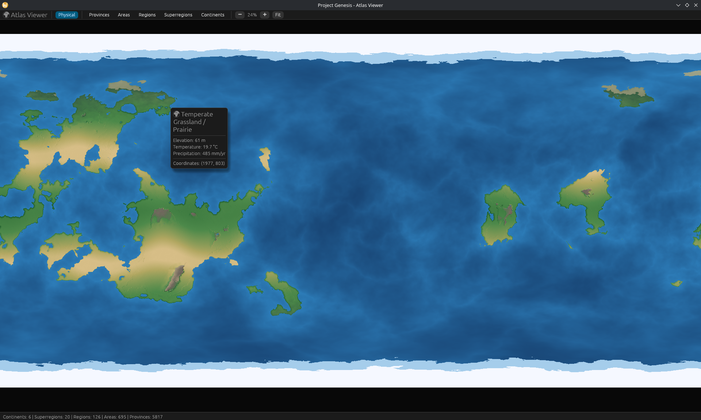
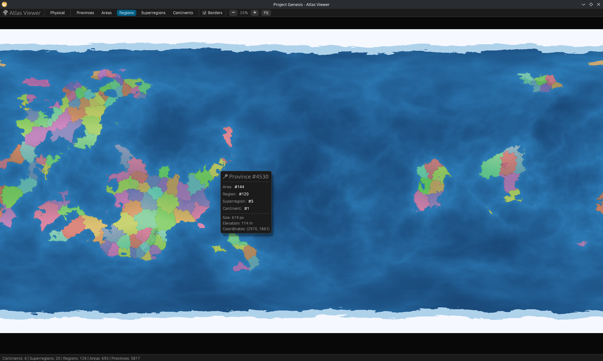
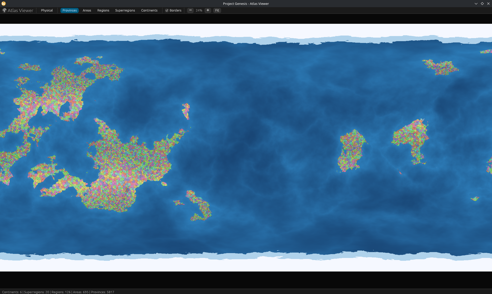

# Project Genesis

A procedural world generator and interactive desktop atlas viewer written in Rust.

The engine generates 8K ($8192 \times 4096$) planetary maps using 3D spherical noise, simulated atmospheric circulation, and hydrology, then partitions the landmasses into a multi-tier geopolitical hierarchy (provinces, areas, regions, superregions, and continents).

---

## Atlas Viewer

| Physical Map | Regional Map | Provincial Map |
| :---: | :---: | :---: |
|  |  |  |

An integrated desktop viewer built with `eframe`/`egui` featuring real-time pan/zoom, map mode toggles, and hover telemetry for individual provinces.

---

## Pipeline

1. **Geology & Tectonics:** Continental crust and mountain cordilleras evaluated on a 3D unit sphere to eliminate polar distortion and Voronoi seams. Includes particle-based hydraulic and thermal erosion passes.
2. **Atmosphere & Climate:** 4-pillar atmospheric model simulating ITCZ convection, subtropical Hadley cell downwelling, Coriolis trade winds, and orographic rain shadows.
3. **Hydrology:** Barnes Priority-Flood depression resolution, freshwater rift lakes, and D8 flow accumulation driving dendritic river systems.
4. **Geopolitical Hierarchy:** 
   - Graph-based clustering with Lloyd relaxation to partition landmasses into **Areas $\rightarrow$ Regions $\rightarrow$ Superregions $\rightarrow$ Continents**.
   - Habitability-weighted seeding (thousands of provinces, scaled to the world's settled land) snapping to natural terrain barriers (mountain crests, rivers, coasts).
   - Impassable "wastelands" driven by geography rather than noise: the hearts of continental deserts, high massifs/plateaus, deep rainforest interiors and polar ice. The permanent polar caps, deep ice-locked continents and the frozen seas the atlas renders as "polar land" — are *mandatory* wasteland: they are never counted against the wilderness budget, and they stop provinces from sprawling to the pole (where the converging longitudes used to stretch single provinces into paper-thin bands). Coastal belts and river corridors are always settled, so no landmass is ever severed into disconnected province networks. A wilderness budget keeps any single seed from drowning in wasteland.
5. **Cartography & Rendering:** Swiss-style multi-angle hillshading combined with a natural atlas hypsometric palette.

---

## Usage

```bash
# Generate a new world from seed and save cache
cargo run --release -- 1980 --save

# Launch the interactive atlas viewer using cached data
cargo run --release -- 1980 --load --viewer

# Generate headless with a random seed
cargo run --release
```