# Project Genesis

A deterministic procedural planet generator and interactive desktop atlas written in Rust. It simulates 3D spherical tectonics, erosion, climate, and hydrology, partitions land and ocean into five-tier hierarchies, and generates early civilizations, religions, and languages up to 16K resolution (`16384 × 8192`).

[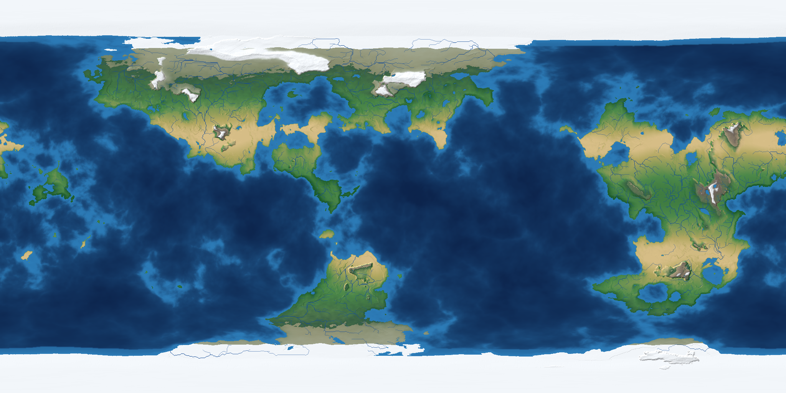](./world_physical_map.png)

*Seed `2807809920` (`4096 × 2048`) at Year 2 120 — 7 502 inhabited provinces, 212 societies (34 states), 34 811 717 inhabitants, 123 religions, and 30 language families.*

## Map Modes

All plates below are rendered by the shared map painter from `saved_seeds/world_2807809920_4096x2048.bin`.

| Physical | Topographic | Climate |
| :---: | :---: | :---: |
| [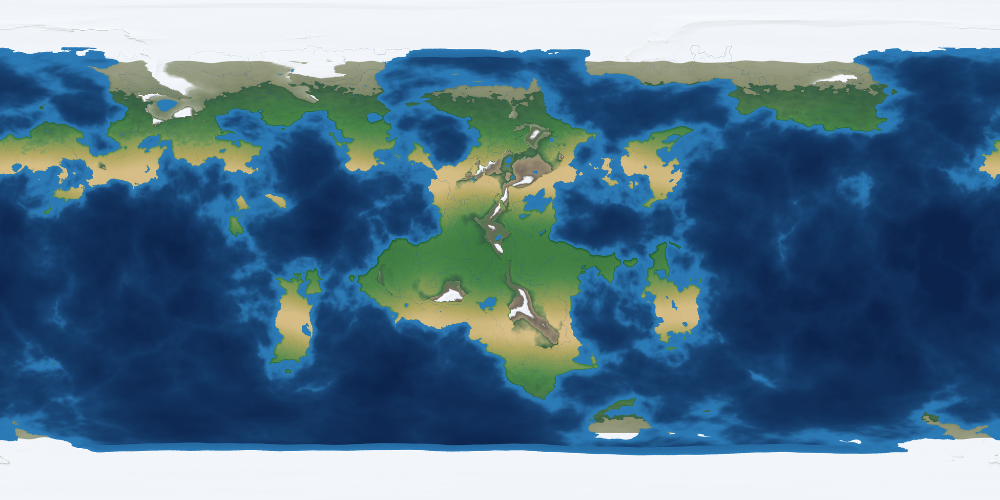](./exports/atlas_physical.png) | [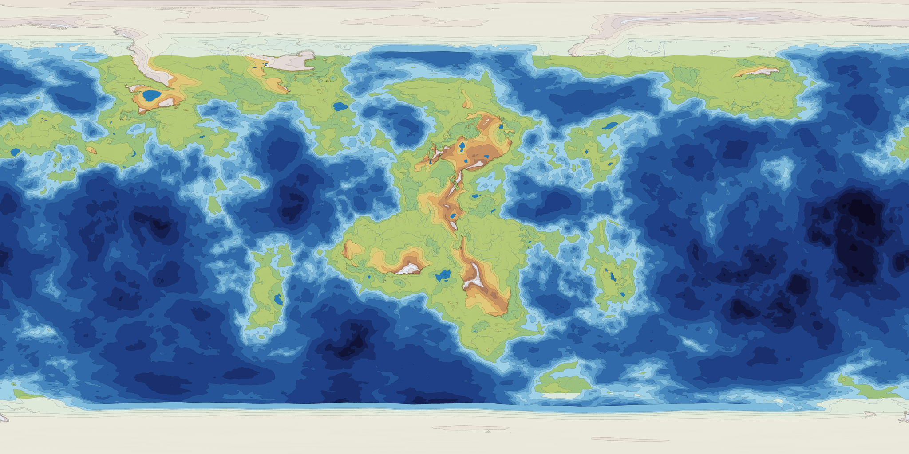](./exports/atlas_topographic.png) | [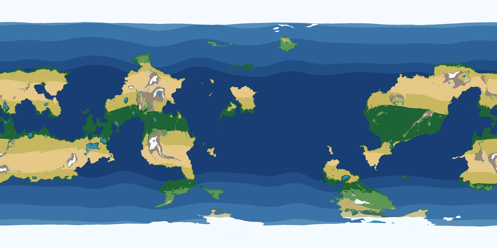](./exports/atlas_climate.png) |

| Civilizations | Religions | Languages |
| :---: | :---: | :---: |
| [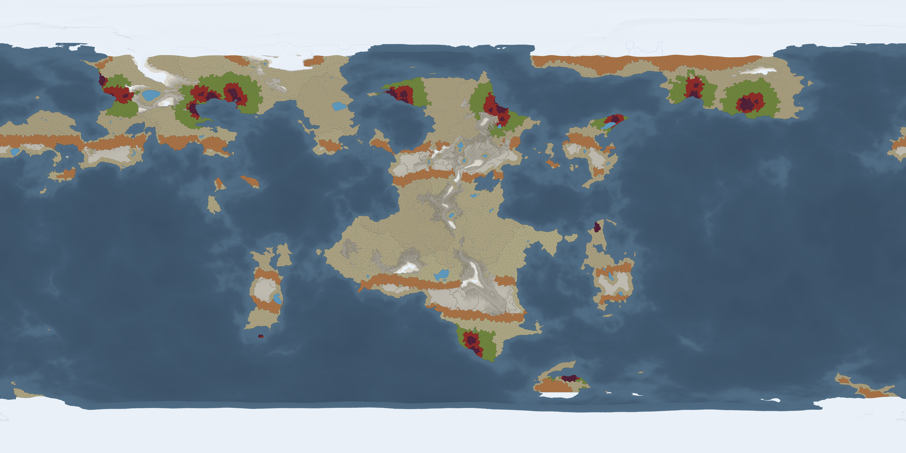](./exports/atlas_civilizations.png) | [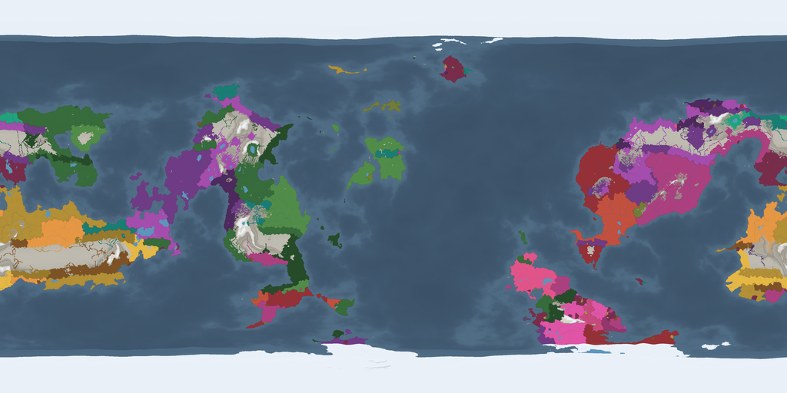](./exports/atlas_religions.png) | [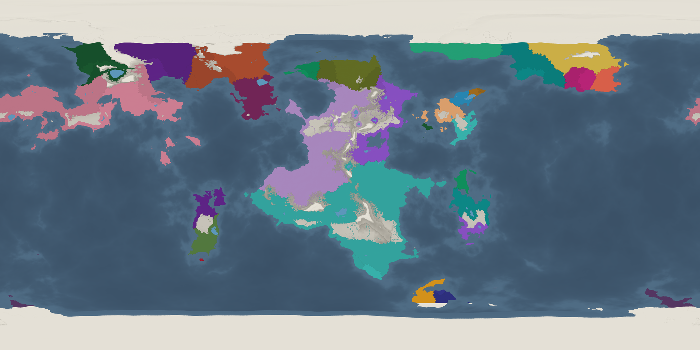](./exports/atlas_languages.png) |

| Land Regions | Ocean Regions | Combined (`Everywhere`) |
| :---: | :---: | :---: |
| [](./exports/atlas_land_regions.png) | [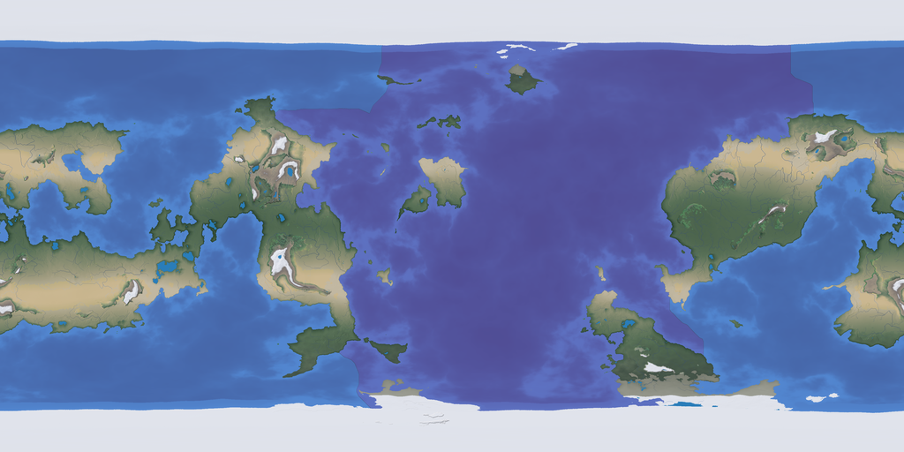](./exports/atlas_water_regions.png) | [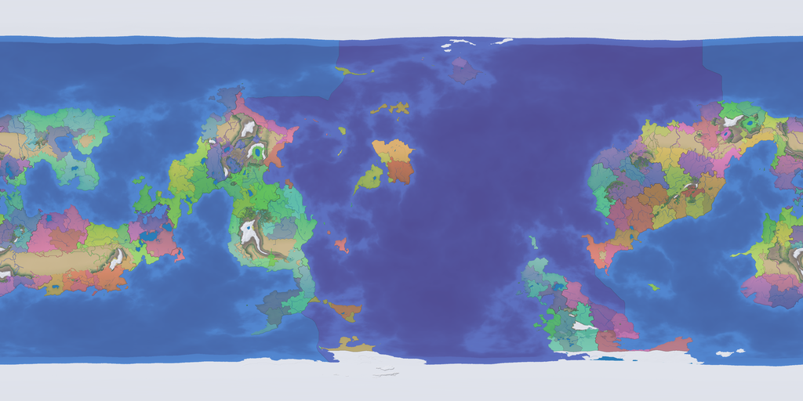](./exports/atlas_everywhere_regions.png) |

<details>
<summary>More map modes &amp; hierarchy tiers (Temperature, Terrain, and 5-tier Land/Ocean cascades)</summary>

| Temperature | Terrain |
| :---: | :---: |
| [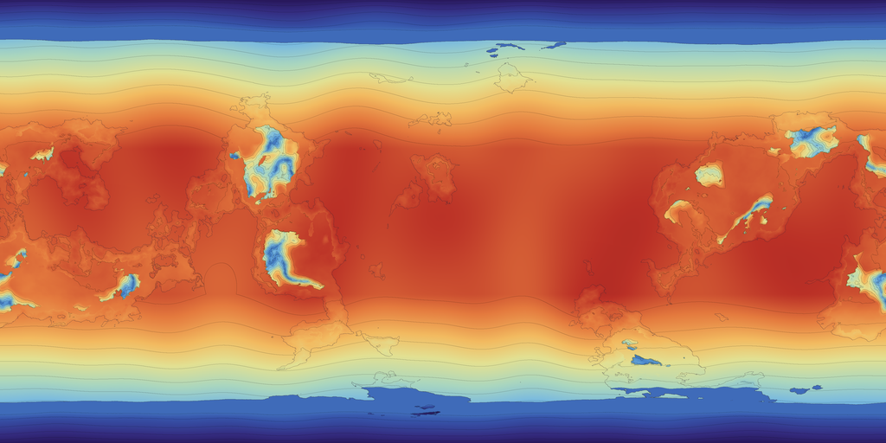](./exports/atlas_temperature.png) | [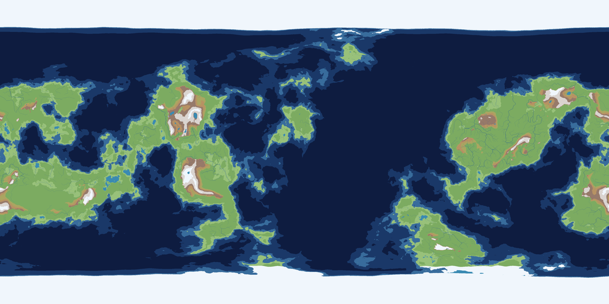](./exports/atlas_terrain.png) |

**Land hierarchy (`Province → Area → Region → Superregion → Continent`)**

| Provinces | Areas | Regions | Superregions | Continents |
| :---: | :---: | :---: | :---: | :---: |
| [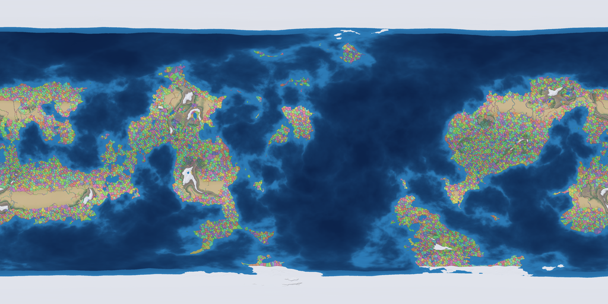](./exports/atlas_land_provinces.png) | [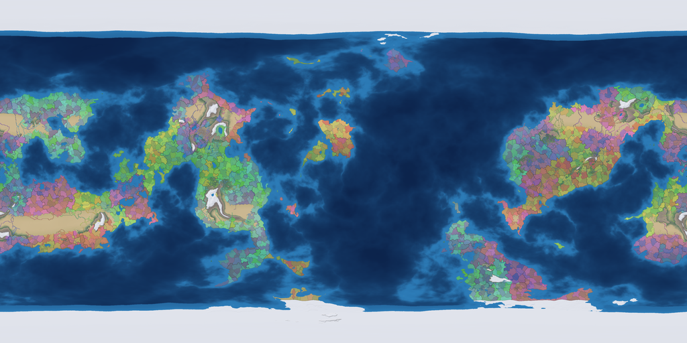](./exports/atlas_land_areas.png) | [](./exports/atlas_land_regions.png) | [](./exports/atlas_land_superregions.png) | [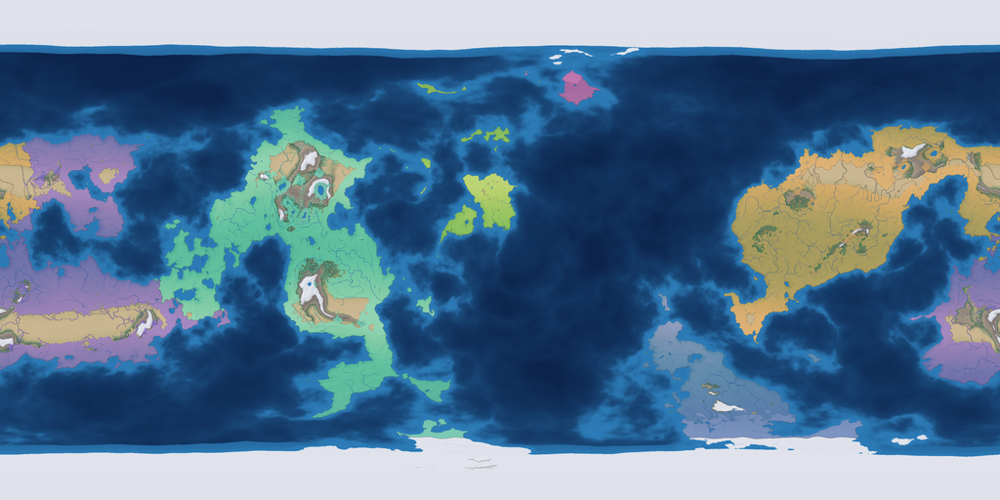](./exports/atlas_land_continents.png) |

**Ocean hierarchy (`Marine province → Area → Region → Superregion → Basin`)**

| Marine provinces | Oceanic areas | Oceanic regions | Oceanic superregions | Ocean basins |
| :---: | :---: | :---: | :---: | :---: |
| [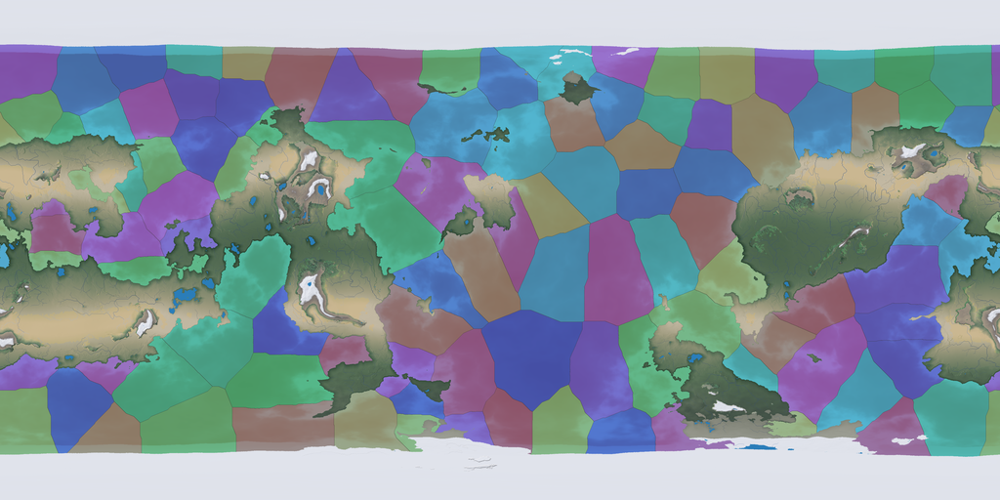](./exports/atlas_water_provinces.png) | [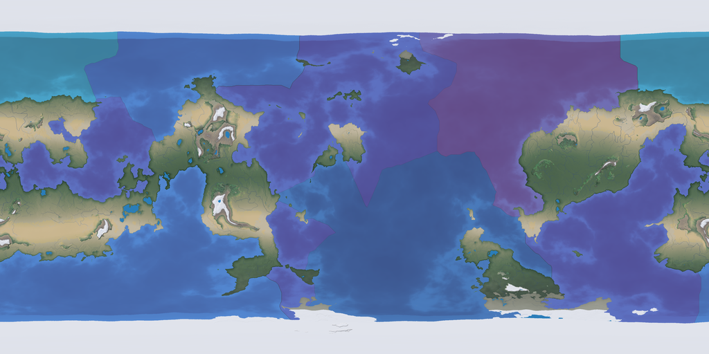](./exports/atlas_water_areas.png) | [](./exports/atlas_water_regions.png) | [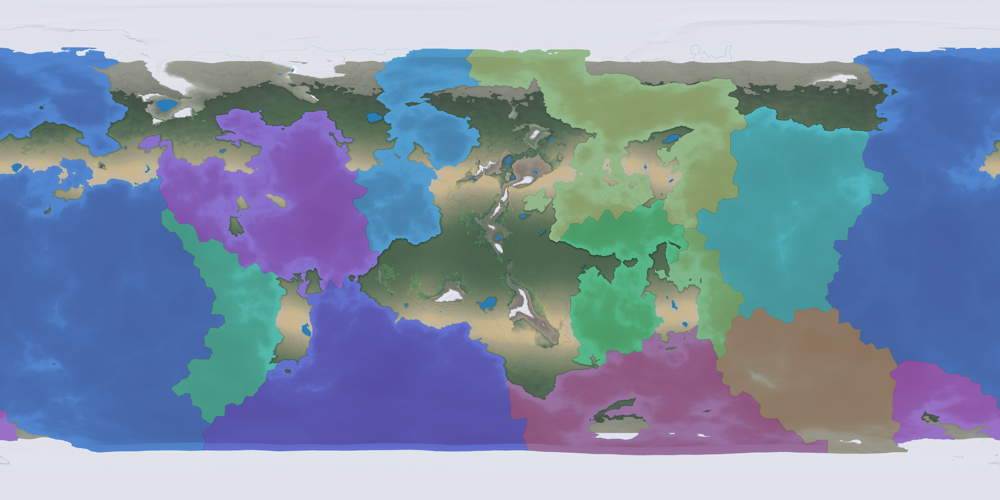](./exports/atlas_water_superregions.png) | [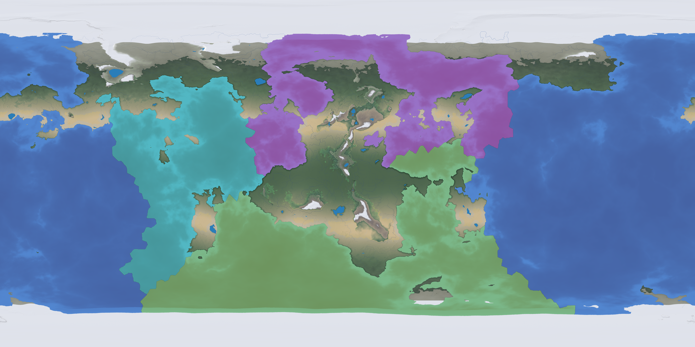](./exports/atlas_water_basins.png) |

</details>

## Quick Start

Requires Rust 1.85+ (edition 2024). Prebuilt Linux binaries are available on [GitHub Releases](https://github.com/Antares6134/Project-Genesis/releases).

```bash
cargo build --release
cargo run --release -- --viewer                                                      # open interactive viewer (8K default)
cargo run --release -- 2807809920 --width 4096 --height 2048 --load --viewer         # load cached 4K world in viewer
cargo run --release -- 2807809920 --width 4096 --height 2048 --save --civs --langs   # generate headlessly, save, print reports
cargo run --release -- 2807809920 --width 4096 --height 2048 --load --plates         # re-export all 19 gallery plates
```

Headless runs always export `world_physical_map.png`, `world_topographic_map.png`, and `world_political_map.png`, plus `world_civilizations_map.png`, `world_languages_map.png`, and `world_religions_map.png` whenever history is run (`--civs`, `--civs-all`, `--langs`, or `--plates`).

## Generation Pipeline

| Stage | What it computes |
| :--- | :--- |
| 1. **Geology & Erosion** | Tectonic plates, 3D spherical fBm noise, hydraulic droplet erosion, thermal talus slumping, and natural sea straits mapped to a piecewise vertical datum (`−11 000 m` trench to `+9 000 m` peak, sea level at `0.40`). |
| 2. **Atmospheric Climate** | Latitude/altitude temperature lapse (rotating Hadley/Ferrel or tidally locked mode), prevailing wind belts, and moisture advection with orographic rain shadows. |
| 3. **Hydrology & Rivers** | Barnes Priority-Flood depression filling, polar ice cap/pack resolution, rift lakes, and D8 flow accumulation into river networks. |
| 4. **Geography & Provinces** | Habitability-weighted land provinces with geography-driven wastelands, plus bathymetry-aware Poisson-disc marine provinces across open and frozen seas. |
| 5. **Geopolitical Hierarchy** | Bottom-up land graph clustering into nested `Provinces → Areas → Regions → Superregions → Continents`. |
| 6. **Hydro-Political Hierarchy** | Bottom-up ocean graph clustering into matching `Marine provinces → Areas → Regions → Superregions → Basins`. |
| 7. **History & Languages** | Cradle selection, five society tiers (Hunter-Gatherers to State Societies), early Copper & Alloys development, seven-level faiths consolidated along land frontiers, and phonology-driven proto-lexicons for naming realms, sites, and deities. |

## Interactive Atlas

[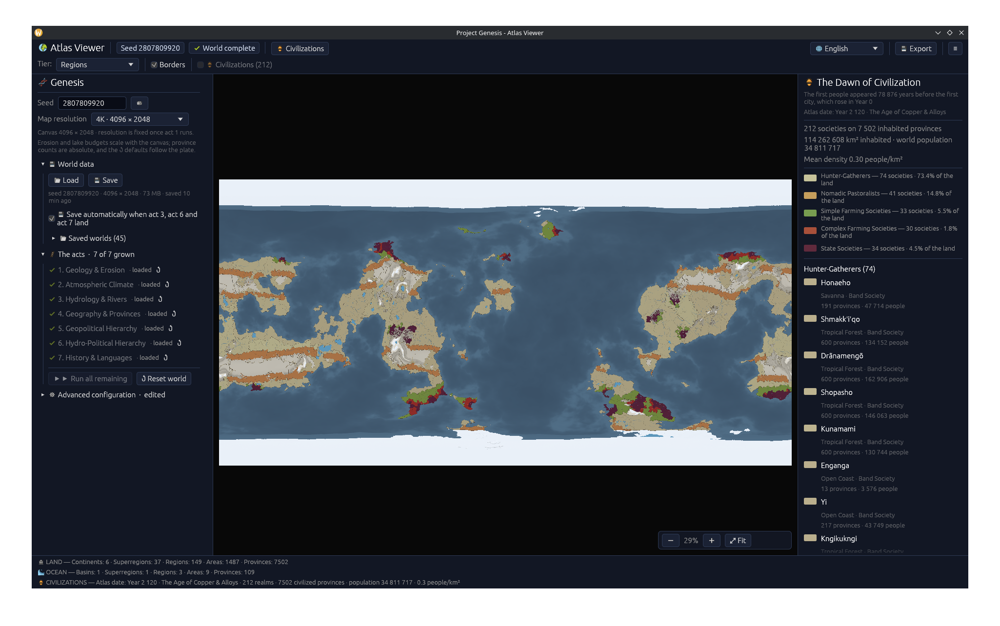](./exports/viewer_ui.png)

- **Step-by-step live execution** — Runs each stage on a background worker thread with live low-resolution canvas previews, per-stage rewind (`↺`), and mid-pipeline seed changes.
- **11 map modes & inspection** — Switch between Physical, Topographic, Climate, Temperature, Terrain, Civilizations, Religions, Languages, Land, Water, and Everywhere; toggle hierarchy tiers, borders, and the civilizations overlay; inspect elevation, biome, polity, creed, and language on hover.
- **Resolutions & tuning** — Presets from 2K to 16K (8K default in viewer, 16K default headless) plus 30 tunable parameters in **Advanced configuration** (applied to subsequent stages).
- **Caching & PNG export** — Lossless `zstd`-compressed `PGZ3` saves (`saved_seeds/world_<seed>_<width>x<height>.bin`) store generated stages alongside their configuration; exports render 2K, 8K, or native PNGs to `exports/`.
- **Localization** — UI strings, legends, tooltips, and settings are available in English (`en`), Español (`es`), Français (`fr`), Deutsch (`de`), Português (`pt`), and Türkçe (`tr`).

<details>
<summary>Sample dossier output from seed 2807809920 (<code>--load --civs --langs</code>)</summary>

```text
── Dawn of civilization (seed 2807809920) ─────────────────────
   The first people appeared 78 876 years before the first city, which rose in Year 0
   Atlas date: Year 2 120 | 212 societies on 7502 inhabited provinces | 114 262 608 km² | population 34 811 717
     Hunter-Gatherers             74 societies ·   5534 provinces ·  73.4% of the land ·   1 298 990 people
     Nomadic Pastoralists         41 societies ·    945 provinces ·  14.8% of the land ·   1 265 348 people
     Simple Farming Societies     33 societies ·    590 provinces ·   5.5% of the land ·   4 608 967 people
     Complex Farming Societies    30 societies ·    158 provinces ·   1.8% of the land ·   5 810 860 people
     State Societies              34 societies ·    275 provinces ·   4.5% of the land ·  21 827 552 people
   World age: The Age of Copper & Alloys (the Metallurgical age)
   123 religions · 78 kept in more than one realm · 22 kept in one province

   🏺 Haenaetaewa
      Scholarly · Sedentary
      Society:     Organized State
      Cradle:      Open Coast
      Economy:     Fishing and Seafaring
      Faith:       Viyaeny (100% of its people)
        Creed:     Polytheism · Polycentric
        Goddesses: Trade (Raeya) · Water (We) · Lunar (Se)
        Cosmos:    Eternal · Cyclical · Endless Continuity · Oblivion
        Temple:    Ecclesiarchy · State Patronage
      Polity:      Aristocratic Republic (Warrior-Elite)
      Capital:     Province #311 | Area: 82 425 km² | Population: 637 380 (7.7/km²) | Founded: Year 0

── Languages & Phonetics (seed 2807809920) ───────────────────
   30 families · 54 languages · 7502 inhabited provinces · 34 811 717 people
   🗣 Namave (Melodic) — Namami | Urheimat: province #2207 | 733 provinces | 572 301 people
   🗣 Kngikudi (Nasal) — Kngiku'ngu | Urheimat: province #4732 | 696 provinces | 340 172 people
   🗣 Mã'arõ (Nasal) — Mã'ayi | Urheimat: province #3804 | 672 provinces | 270 567 people
   🗣 Aepsukho (Glottal) — Aepsushe | Urheimat: province #5905 | 655 provinces | 1 024 791 people
```

</details>

## CLI Options

| Flag | Description |
| :--- | :--- |
| `<seed>` | Unsigned integer seed (default `42`). |
| `--viewer` | Launch the interactive desktop atlas (starts at `8192 × 4096`). |
| `--headless` | Run without a window (default when `--viewer` is omitted; starts at `16384 × 8192`). |
| `--save` | Write `saved_seeds/world_<seed>_<width>x<height>.bin` automatically at stages 3, 6, and 7. |
| `--load` | Load a cached world (and its saved settings) instead of regenerating completed stages. |
| `--width <px>` / `--height <px>` | Override canvas dimensions in either mode. |
| `--provinces <n>` | Override target mean land-province count (each seed varies within ±7.5%). |
| `--religion-consolidation <x>` | Override religion consolidation factor (`0.50`–`10.0`). |
| `--civs` / `--civs-all` | Run stage 7 and print state dossiers (`--civs-all` prints every society). |
| `--langs` | Run stage 7 and print language families, proto-roots, and named realms/faiths. |
| `--plates` | Run stage 7 and export the 19 `exports/atlas_*.png` gallery plates. |
| `--lang <code>` | Set viewer UI language (`en`, `es`, `fr`, `de`, `pt`, `tr`). |

## Project Layout

| Path | Contents |
| :--- | :--- |
| [`src/core/`](src/core/) | Grid storage, spherical geometry, vertical datum, polar ice, binary `PGZ3` caching. |
| [`src/terrain/`](src/terrain/) | Tectonics, fractal noise, hydraulic and thermal erosion, sea straits. |
| [`src/climate/`](src/climate/) | Wind circulation, temperature lapse, moisture advection. |
| [`src/hydrology/`](src/hydrology/) | Priority-Flood depression fill, lakes, D8 flow, rivers. |
| [`src/geography/`](src/geography/) | Land and ocean province partitioning, wasteland masks. |
| [`src/geopolitics/`](src/geopolitics/) | Province adjacency graphs and five-tier land/ocean clustering. |
| [`src/civilization/`](src/civilization/) | Cradles, society tiers, timeline/ages, seven-level faiths, CLI reports. |
| [`src/language/`](src/language/) | Phonology DNA, 100-root proto-lexicons, graph diffusion, realm/sacred naming. |
| [`src/pipeline.rs`](src/pipeline.rs) | Seven-stage pipeline state, `WorldGenSettings`, cache integration. |
| [`src/export/`](src/export/) | Shared map palettes, legends, and headless PNG renderers. |
| [`src/viewer.rs`](src/viewer.rs), [`src/viewer/`](src/viewer/) | `eframe`/`egui` desktop UI, settings panel, localization, themes. |
| [`src/main.rs`](src/main.rs) | CLI argument parsing and headless/viewer entrypoints. |

### Third-Party Assets

UI icons use subset fonts bundled in [`assets/fonts/`](assets/fonts/): **OpenMoji Color** (© OpenMoji authors, [CC BY-SA 4.0](assets/fonts/LICENSE-OpenMoji.txt)) and **Adwaita Mono** (© Renzhi Li, [SIL OFL 1.1](assets/fonts/LICENSE-AdwaitaMono.txt)).
