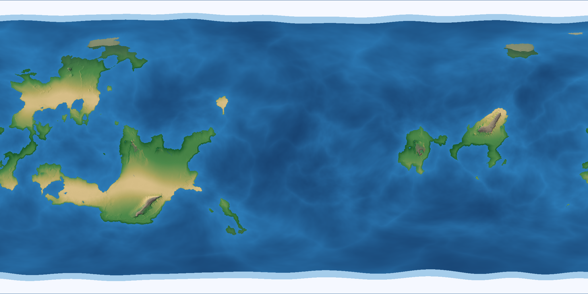

# Project Genesis 🌍

A high-performance, physically-grounded procedural planetary engine written in Rust.

Instead of relying on crude 2D heightmap noise, Project Genesis simulates planetary geology, atmospheric circulation, and hydrology across a **3D Unit Sphere** to generate seamless, photorealistic worlds without cylindrical distortion or seam lines.



## Core Architectural Systems

* **3D Spherical Tectonics:** Evaluates multi-octave coherent noise on a 3D unit sphere to eliminate Voronoi polygon seams and polar distortion, generating massive continental cratons, deep ocean basins, and continental shelves.
* **Continuous Sinuous Orogeny:** Simulates narrow, knife-edge mountain cordilleras (Andes and Himalayas scale) along tectonic fault lines using ridged multi-fractals.
* **Atmospheric Circulation (The 4-Pillar Model):**
  * Intertropical Convergence Zone (ITCZ) equatorial convection.
  * Subtropical Hadley downwelling (arid desert basins).
  * Prevailing Coriolis wind advection (Westerlies & Trade Winds).
  * Orographic precipitation and leeward rain shadows.
* **Hydrology & River Routing:** 
  * Uses the **Barnes Priority-Flood** algorithm to resolve sinkholes and detect inland tectonic rift lakes.
  * D8 flow routing with topological accumulation driven by local precipitation.
  * Anti-aliased arterial river channels with volume-dependent widths.
* **Cartographic Shaded Relief:** Swiss-style multi-angle hillshading combined with an authentic physical atlas hypsometric palette (Natural Earth / National Geographic style).
* **Multi-Threaded (Rayon):** Generates complete 2-million pixel ($2048 \times 1024$) worlds with erosion in under 1 second.

## Technology Stack
* **Language:** Rust
* **Concurrency:** `rayon` (data-parallelism across all CPU cores)
* **Procedural Math:** `noise-rs` (OpenSimplex 3D/4D), `rand`, `rand_chacha`
* **Image Processing:** `image`

## Quick Start

```bash
# Build and run with a random seed
cargo run --release

# Run with a specific deterministic seed
cargo run --release -- 1980
```